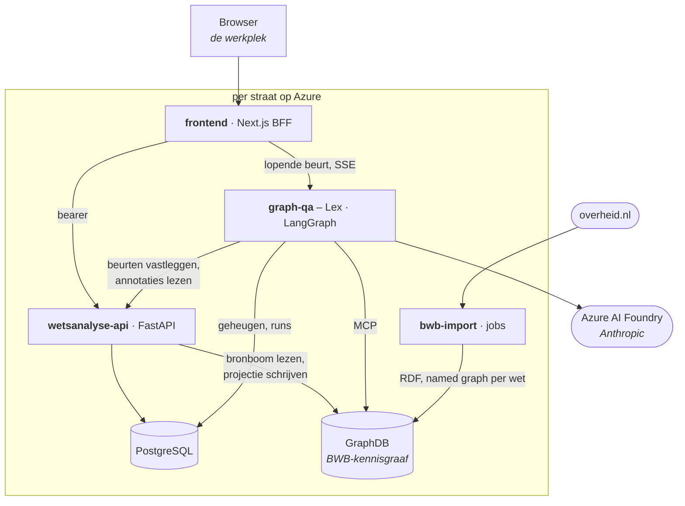

# Wetsanalyse

Agent-platform dat Nederlandse wet- en regelgeving brongetrouw en traceerbaar duidt volgens de methode
Wetsanalyse en het Juridisch Analyseschema (JAS).

> [!NOTE]
> **Status: werkend prototype in actieve ontwikkeling.** Acceptatie en productie draaien met proefdata.
> Dit is een persoonlijk project, geen officiële dienst of product van de Belastingdienst of de
> Rijksoverheid.

## Wat het is en voor wie

Een jurist die een wetsartikel klaarmaakt voor uitvoering – een uitkering, een aanslag, een vergunning –
moet expliciet maken wie het rechtssubject is, welke voorwaarden gelden, welke termijn telt en waar een
begrip gedefinieerd staat. Dat gebeurt nu grotendeels in Word en in hoofden: het kost veel tijd, het
resultaat is moeilijk herleidbaar naar de wettekst, en bij een wetswijziging begint het opnieuw.

Dit platform is voor juristen en analisten die dat werk doen volgens de methode Wetsanalyse (Ausems,
Bulles & Lokin). Het uitgangspunt is dat **de AI produceert en de mens beoordeelt**:

- **Brongetrouw.** Alleen letterlijk opgehaalde wettekst. Elk voorstel is herleidbaar naar artikel, lid
  en `bronreferentie` (jci-uri).
- **Traceerbaar.** Elke beslissing van de jurist landt in een append-only auditlog.
- **Geen schijnzekerheid.** Twijfel en aannames worden zichtbaar gemaakt, niet weggepoetst. Het platform
  is een hulpmiddel voor de jurist, geen vervanger.

## Wat je ermee doet

Alles begint in één gesprek met de agent **Lex**, en wat Lex oplevert opent naast dat gesprek om te
beoordelen.

1. **Vragen stellen over wetgeving.** Lex antwoordt vanuit de kennisgraaf, met bronnen uit wat hij
   werkelijk ophaalde en een controle op elk citaat.
2. **Een werkgebied samenstellen** (activiteit 1). Met vraagkaarten leg je naam, aanleiding, doel,
   analysevraag, praktijkvoorbeeld, deelvragen en afbakening vast.
3. **Bronnen kiezen per deelvraag.** Lex zoekt kernbepalingen en wat eraan hangt; jij neemt op of sluit uit.
4. **Bepalingen annoteren** (activiteit 2). Detectoren bepalen de fragmentgrenzen en de mogelijke klassen,
   een kleine classifier kiest in de dertien JAS-klassen, en een gerichte reviewer kijkt alleen naar
   twijfelgevallen. Jij keurt goed, corrigeert of wijst af.
5. **Begrippen formuleren** (begin van activiteit 3). Begripskaarten rusten op annotatiepassages, met
   beoordeling, historie, relaties en een NL-SBB-export. Een begrip kan generiek worden en boven de
   werkgebieden staan.

> [!IMPORTANT]
> **Scope: activiteit 2, en het begin van activiteit 3.** Afleidingsregels en de
> RegelSpraak-formalisering zijn *niet* gebouwd. De annotatiecontracten dragen `scope: "act2"`.

## Opbouw

De webapp is de enige die een mens ziet. Zij praat met de API voor alles wat bewaard moet blijven, en
rechtstreeks met de agent voor de lopende beurt (SSE). De API is de waarheid over annotaties en
begrippen (PostgreSQL) en projecteert ze naar de graaf.



Per straat draaien vijf container apps (frontend, api, graph-qa, GraphDB, OTel-collector), drie jobs
(wekelijkse import, graafwacht, eval) en PostgreSQL. Optioneel komen daar de MCP-proxy naar de graaf en
één Grafana bij.

| Onderdeel | Map | Wat het doet |
|---|---|---|
| **frontend** | [`frontend/`](frontend/README.md) | Next.js-webapp en BFF: de werkplek, annotaties, werkgebieden, begrippen, login en beheer. |
| **wetsanalyse-api** | [`api/`](api/README.md) | Headless FastAPI. Annotaties, werkgebieden, begrippen, gesprekken, gebruikers, modelprofielen, tokenbudget. |
| **graph-qa (Lex)** | [`tools/graph-qa/`](tools/graph-qa/README.md) | De agent: één LangGraph-graaf met een supervisor boven de routes voor antwoorden, annoteren, werkgebieden, bronselectie en begrippen. |
| **bwb-import** | [`tools/bwb-import/`](tools/bwb-import/README.md) | Haalt wettekst bij overheid.nl en schrijft RDF naar GraphDB, per wet idempotent. |
| **bronmodel** | [`packages/bronmodel/`](packages/bronmodel/README.md) | Gedeeld Python-pakket: bronboom, snapshot-ID's, teksthashes en tekstankers. |
| **uitrol** | [`deploy/azure/`](deploy/azure/README.md) | Bicep voor de straten, GraphDB 11.4 met de ingebouwde MCP-server, en Grafana. |
| **de skill** | [`.claude/skills/wetsanalyse/`](.claude/skills/wetsanalyse/SKILL.md) | De JAS-methode als inhoudelijke bron, en build-input van graph-qa. |
| **MCP-hulpmiddelen** | [`admin`](tools/wetsanalyse-admin-mcp/README.md) · [`acceptatie`](tools/wetsanalyse-acceptatie-mcp/README.md) | De admin-API als tools, en de webapp op acceptatie bedienen zoals een gebruiker. |
| **nl-sbb-begrip** | [`tools/nl-sbb-begrip/`](tools/nl-sbb-begrip/README.md) | Side project: één NL-SBB-definitie als losse bestanden. |

De naam **Lex** is wat de gebruiker ziet; de code, het image en de env-variabelen heten `graph-qa`.

## Kernbegrippen

| Begrip | Betekenis |
|---|---|
| **JAS** | Juridisch Analyseschema: dertien klassen waarin een wetsformulering wordt ingedeeld ([uitleg per klasse](.claude/skills/wetsanalyse/references/jas-klassen-referentie.md)). |
| **werkgebied** | De analyse-eenheid: bepalingen rond één analysevraag, met deelvragen en een dossier. |
| **deelvraag** | Een onderdeel van de analysevraag. Bronnen worden per deelvraag gekozen. |
| **bron** | Eén `bwbId` + `artikel` + optioneel `lid`. De kleinste citeerbare eenheid. |
| **bronnode** | Een artikel, lid of onderdeel in de graaf. Een annotatielaag hoort bij precies één bronnode. |
| **begrip** | Een door de analist geformuleerde betekenis, gekoppeld aan de passages die haar dragen. Een analyse-uitkomst, geen wettelijke definitie. |
| **artefact** | Wat een beurt van Lex oplevert en naast het gesprek opent: annotatie, werkgebied, deelvraag, bronselectie, begrip of begrippenvoorstellen. |
| **grounding** | Deterministische controle of elke vindplaats en elk citaat uit wat Lex ophaalde komt. |
| **straat** | Een zelfstandige omgeving op Azure: *acceptatie* of *productie*. |

## Snel starten

Azure is het enige uitrolpad; er is geen gedeelde dev-omgeving. Lokaal start elk onderdeel apart. Voor
de webapp zijn alleen de API en PostgreSQL nodig.

Vereist: [uv](https://docs.astral.sh/uv/) met Python ≥ 3.11, Node.js (CI draait op 26) en Docker voor
PostgreSQL.

**1. PostgreSQL en de API**

```bash
docker run -d -p 5432:5432 --name wetsanalyse-postgres-lokaal \
  -e POSTGRES_USER=wetsanalyse -e POSTGRES_PASSWORD=wetsanalyse -e POSTGRES_DB=wetsanalyse postgres:16
```

```bash
cd api
cp .env.example .env
uv sync --extra llm --extra dev
uv run --env-file .env uvicorn app.main:app --reload --port 3000
```

De voorbeeldwaarden zijn genoeg om te starten. Controleer met <http://localhost:3000/ready>.

**2. De webapp**, in een tweede shell:

```bash
cd frontend
cp .env.example .env.local
sed -i 's#^API_BASE_URL=.*#API_BASE_URL=http://localhost:3000#' .env.local
sed -i "s#^AUTH_SECRET=.*#AUTH_SECRET=$(openssl rand -base64 32)#" .env.local
npm install
npm run dev -- -p 3001
```

Open <http://localhost:3001/login>: de eerste keer stuurt de app je door naar `/setup`, waar je de eerste
beheerder aanmaakt. Beheer vraagt daarna 2FA, en daarvoor moet `LLM_CONFIG_SECRET` op de API gezet zijn
(zie [de API](api/README.md#lokaal-draaien)).

**3. Verder.** Lex vraagt een bereikbare GraphDB ≥ 11.2 en een Azure AI Foundry-sleutel; zie
[graph-qa](tools/graph-qa/README.md#lokaal-draaien). De graaf vul je met de
[importer](tools/bwb-import/README.md#installatie). GraphDB vraagt een eigen licentie van Ontotext.

## Ontwikkelen

Lees eerst [`CLAUDE.md`](CLAUDE.md): dat is het overzicht voor wie code wijzigt, met per onderdeel een
eigen `CLAUDE.md` ([api](api/CLAUDE.md) · [frontend](frontend/CLAUDE.md) ·
[graph-qa](tools/graph-qa/CLAUDE.md)). Bouwen en testen staan in de README van elk onderdeel.

```bash
git config core.hooksPath .githooks     # eenmalig per kloon: de pre-push-hook draait de suites die je raakt
```

De verplichte PR-check `poort` draait ook alleen de suites van wat je raakt, plus de contract- en vormtests
in `scripts/kruistests.sh`. Twee bestanden zijn gegenereerd uit de skill: wil je het gedrag van de agent
bijsturen, bewerk dan de markdown en draai het script (zie [`CLAUDE.md`](CLAUDE.md)).

## Uitrollen

Twee straten op Azure Container Apps. Een merge naar `master` rolt uit naar **acceptatie**, dat tevens de
proeftuin is. **Productie** gaat via een tag `v*`: `promote.yml` bouwt niets, maar neemt de digests over
die op acceptatie draaien, achter een required reviewer. Terugrollen gaat met `rollback.yml`, en infra
blijft handmatig via `azure-infra.yml`. Het runbook staat in
[`deploy/azure/README.md`](deploy/azure/README.md).

## Beveiliging en privacy

- **Login.** Gebruikers loggen in op de webapp (Auth.js, bcrypt). TOTP-2FA is optioneel, behalve voor
  beheer. De BFF praat server-naar-server met een token dat de browser nooit ziet.
- **Gesprekken per gebruiker, annotaties gedeeld.** Een gesprek van een ander geeft een 404. Annotaties
  en werkgebieden zijn gedeeld; wie wat deed staat in de audit.
- **Versleuteld at rest.** API-keys van modelprofielen en 2FA-secrets, met dezelfde Fernet-sleutel.
- **Netwerkgrens.** GraphDB draait zonder eigen security en is alleen binnen de Container Apps Environment
  bereikbaar; `poort` bewaakt dat. De api is alleen op acceptatie publiek.
- **De repo is publiek.** Een CI-guard blokkeert hostnamen, interne IP's en machinenamen.
- **Afhankelijkheden.** `pip-audit` bij de Python-onderdelen en `npm audit` bij de frontend, Trivy met een
  gate op HIGH en CRITICAL op alle images, en wekelijks Dependabot.

## Beperkingen

- **Geen afleidingsregels en geen RegelSpraak.** Die horen nog niet tot de functionaliteit.
- **De graaf op Azure is niet-persistent.** GraphDB kan geen netwerkschijf gebruiken. De graaf is volledig
  reproduceerbaar uit overheid.nl en vult zichzelf: na een deploy, wekelijks, en via de graafwacht binnen
  een kwartier na verlies. Tot dan is hij leeg.
- **Geen migratietool.** Bij het starten worden ontbrekende tabellen, kolommen en indexen toegevoegd;
  hernoemen of van type wisselen gaat zo niet.
- **Een beurt overleeft geen herstart van haar replica.** Meelezen en stoppen werken over replica's heen,
  de draaiende taak zelf niet.
- **Annotatieruns variëren sterk** tussen draaibeurten over dezelfde bepaling. Trek geen conclusie uit
  één run.
- **Eén LLM-provider.** Anthropic via Azure AI Foundry; een tweede vraagt een nieuwe adapter.

## Verder lezen

| Document | Onderwerp |
|---|---|
| [`docs/README.md`](docs/README.md) | Wegwijzer door `docs/`: bron van derden, specificatie, plan, meting of runbook |
| [`docs/PLAN.md`](docs/PLAN.md) | Het plan: open sporen en open keuzes |
| [`docs/architectuur/annotatieketen.md`](docs/architectuur/annotatieketen.md) | Hoe de annotatieketen nu werkt |
| [`docs/architectuur/annotatie-bronnodes.md`](docs/architectuur/annotatie-bronnodes.md) | Het contract van de annotaties op bronnodes |
| [`docs/architectuur/bronselectie-per-deelvraag.md`](docs/architectuur/bronselectie-per-deelvraag.md) | De bronselectie per deelvraag |
| [`docs/observability.md`](docs/observability.md) | Logschema, tracing door de keten, Grafana, AVG-redactie |
| [`deploy/azure/README.md`](deploy/azure/README.md) | Uitrol, straten, secrets, release-runbook, terugrollen |
| [`.claude/skills/wetsanalyse/`](.claude/skills/wetsanalyse/SKILL.md) | De methode: klassen, fragmentgrenzen, verwijzingen |

## Hulp en bijdragen

Vragen en fouten kun je melden via
[GitHub Issues](https://github.com/palmw01/wetsanalyse-ai/issues); bijdragen graag eerst in overleg.
Meld een beveiligingsprobleem niet in een openbare issue, maar via
[private vulnerability reporting](https://github.com/palmw01/wetsanalyse-ai/security/advisories/new).

## Licentie en herkomst

Copyright © 2026 Willard Palm

*Licensed under the EUPL* – de broncode staat onder de **European Union Public Licence v1.2**, de
licentie die de EU en de Rijksoverheid voor overheidssoftware aanhouden. De volledige tekst staat in
[`LICENSE`](LICENSE); de officiële Nederlandse versie, juridisch gelijkwaardig, in
[`LICENSE.nl`](LICENSE.nl).

Niet alles in deze repository is van ons, en die delen vallen buiten de EUPL:

| Onderdeel | Voorwaarden |
|---|---|
| [`docs/wetsanalyse/wetsanalyse-rijk/`](docs/wetsanalyse/wetsanalyse-rijk/BRON.md) | De methode en het JAS, van het ministerie van BZK, onder de **W3C Software and Document License** – zie de [`LICENSE`](docs/wetsanalyse/wetsanalyse-rijk/LICENSE) in die map. |
| `docs/wetsanalyse/WetsTaal.md` | De WetsTaal-handreiking (Belastingdienst / PNA Group), publiek gepubliceerd. |
| De wettekst in de graaf | Van overheid.nl (SRU + BWB-repository), **CC-0**. Geen API-sleutel nodig. |
| GraphDB | Vereist een eigen licentie van Ontotext; zonder licentiebestand komt de database read-only op. |

Het boek *Wetsanalyse* (Boom uitgevers) en de readers van het Expertisecentrum BRM zijn **geen
onderdeel van deze repository** – dat is materiaal van derden dat niet publiek verspreid hoort te
worden. Wie ze rechtmatig heeft, kan ze lokaal in `docs/wetsanalyse/` plaatsen; `.gitignore` houdt
ze buiten git.
