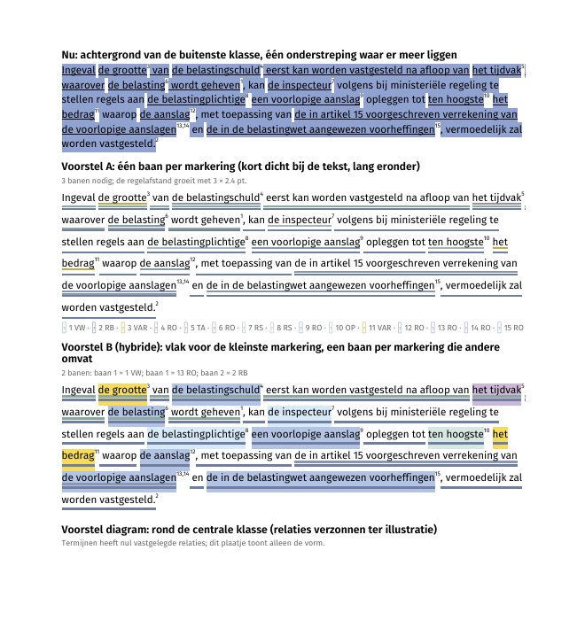
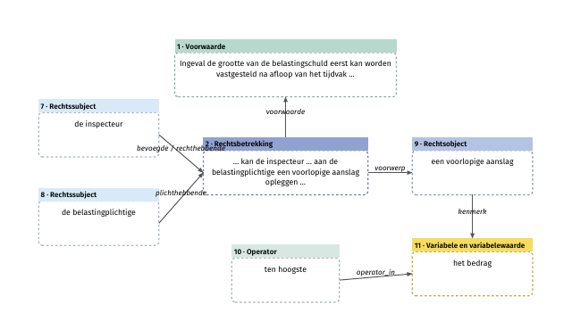

# Voorstel: overlappende markeringen en een diagram per bepaling (concept)

Status: **deel 1 gekozen (18 nov 2026), deel 2 later** · Datum: 2026-11-18 · Hoort bij:
[ADR-009](adr-009-werkgebiedrapport.md), [ADR-011](adr-011-relaties-tussen-markeringen.md),
skill [`references/relaties.md`](../../.claude/skills/wetsanalyse/references/relaties.md)

Aanleiding: het rapport van werkgebied *Termijnen* op acceptatie (18 nov 2026, 82 pagina's, 212 markeringen in
14 bronnen). Er is nog niets gebouwd.

## 1. Overlappende markeringen zijn niet te onderscheiden

### Wat er nu is

Er zijn drie weergaven, met elk een eigen algoritme:

| Plek | Code | Regel | Gevolg |
|---|---|---|---|
| Rapport, PDF | `api/app/pdf_opmaak.py` `gemarkeerd` | achtergrond in de kleur van de **buitenste** markering, één onderstreping waar er meer liggen | een Rechtsbetrekking die de hele zin beslaat kleurt alles blauw; art. 13 lid 1 AWR (20 markeringen) wordt één blauw blok |
| Rapport, Markdown | `api/app/markdown_opmaak.py` | vet met ⁽ⁿ⁾ aan het eind | begin en nesting zijn onzichtbaar |
| Leesvenster en graaf | `frontend/lib/graaf/spans.ts` `spansVan` | per teken de **kortste** markering | de lange markering valt weg, op de gaten tussen de woorden na |
| Annotatiepaneel | `frontend/lib/markeerlaag.ts` `segmenteer` | alleen de **gekozen** markering | bewust zo, omdat "alles kleuren onleesbaar en onvolledig" was; de samenhang zie je nooit |

Het knippen in segmenten bestaat al (`pdf_opmaak._segmenten`); het probleem zit in hoe een segment met meer
markeringen wordt getekend. Elk van de drie lost dat anders op, en geen van de drie toont alles.



*De proef hierboven is met ReportLab gezet, met dezelfde lettertypen en JAS-kleuren als het rapport.*

### De opties

**A. Een baan per markering (het idee van de gebruiker, uitgewerkt).** Knip de tekst op alle grenzen. Elke markering
krijgt één vaste baan over haar hele lengte: korte markeringen dicht bij de tekst, lange eronder. Elke baan is een
gekleurde streep onder het segment. Een baan kiezen is intervalkleuring: sorteer op lengte en geef de laagste vrije
baan. Dat is deterministisch.

- Voor: alles staat erin, met begin en eind. De tekst blijft zwart op wit. Het werkt ook bij overlap die niet
  netjes genest is.
- Tegen: de JAS-kleuren zijn pastel, en als dunne lijn zijn Rechtsobject, Rechtssubject, Rechtsfeit en Operator
  nauwelijks uit elkaar te houden. De regelafstand groeit met het aantal banen (art. 13 lid 1: 3 banen). Bij twee
  korte markeringen naast elkaar is niet te zien waar de ene ophoudt.

**B. Hybride: een vlak voor de kleinste markering, een baan voor wat andere omvat (aanbevolen).** Een markering
die geen andere omvat (de woordniveau-klassen: subject, object, variabele, operator, tijd) krijgt het vlak in haar
JAS-kleur, zoals de jurist het gewend is. Een markering die andere omvat (meestal Rechtsbetrekking, Voorwaarde,
Afleidingsregel, Rechtsfeit, of een samengesteld object) krijgt een dikke baan eronder in haar donkere randkleur.
Het nummer staat in superscript waar een markering eindigt, zoals nu.

- Voor: de kleinere elementen houden hun kleur; de grote liggen eronder als haak. Er zijn veel minder banen nodig
  (art. 13 lid 1: 2 in plaats van 3). Het ziet eruit als de huidige werkplek én het rapport, dus geen nieuwe
  beeldtaal. Het is één regel die op een scherm en op papier werkt.
- Tegen: twee markeringen van dezelfde omvang op dezelfde tekst (twee klassen op hetzelfde fragment) passen niet in
  één vlak. Dan krijgt de tweede een baan. Een vlak kan niet twee kleuren tegelijk hebben. De regel "omvat een
  andere" moet de jurist uit de legenda leren.

**C. Geneste haken.** Zet `⸢ ⸣` met nummer om elke markering, zoals haakjes in een formule.

- Voor: exact, kleurloos, ook in Markdown en bij afdrukken in grijs.
- Tegen: bij twintig markeringen in één zin is de wettekst nauwelijks nog te lezen. Overlap die niet netjes genest
  is, geeft haken die elkaar kruisen.

**D. De tekst per laag herhalen.** Toon het citaat twee keer: eens met de zinsdeelklassen, eens met de
woordklassen.

- Voor: elke weergave is simpel.
- Tegen: de tekst staat dubbel, het rapport wordt langer, en welke klasse in welke laag hoort is een eigen keuze die
  bij een samengesteld rechtsobject al wringt.

**E. Een legenda per segment.** Tekst zonder kleur, en per segment de markeringen die erop liggen.

- Voor: volledig.
- Tegen: op papier is dat een tabel naast de tekst, en die leest niet. Op het scherm werkt het wél als interactie
  (zie hieronder).

### Voorstel

Optie B als één algoritme, in twee talen met gedeelde testvectoren. Dat patroon heeft de repo al voor de
relatiecatalogus (`jasRelaties.vectoren.json`).

- **Het algoritme** `markeerbanen(tekst, markeringen) → segmenten`: per segment de tekst, het vlak (de kleinste
  markering), de banen (markering-id en baannummer) en de nummers die er eindigen. Het rekent in Unicode-codepoints,
  zoals de ankers.
  - In Python in `packages/bronmodel`, naast de tekstankers.
  - In TypeScript in `frontend/lib/markeerbanen.ts`.
  - Beide toetsen tegen `markeerbanen.vectoren.json`, met art. 13 lid 1 AWR als een van de vectoren.
- **Wat weggaat**: `pdf_opmaak._segmenten`/`gemarkeerd`, `graaf/spans.ts` `spansVan` en `markeerlaag.segmenteer`
  (met een test die de oude namen verbiedt).
- **PDF**: ReportLab tekent geneste `<u>` met eigen kleur, dikte en verschuiving (getoetst met ReportLab 5.1, zie de
  proef). De regelafstand van het citaat groeit met het aantal banen. De legenda in de leeswijzer krijgt één zin over
  vlak en baan.
- **Werkplek**: `WettekstBlok` tekent de segmenten. Een baan is een `background-image`-streep onderaan de `<mark>`, met
  `box-decoration-break: clone`. Een klik op een segment opent een klein lijstje met alles wat erop ligt (optie E als
  interactie), en wie daar een markering kiest, licht die op, terwijl de rest dimt. Het annotatiepaneel toont dan
  standaard alles, in plaats van alleen de gekozen markering.
- **Markdown**: kleur kan niet. Daar komt optie C, maar compact: `⸢³de grootte⸣` alleen om markeringen die een andere
  omvatten, plus vet voor de rest zoals nu. Of de Markdown blijft zoals hij is (zie de vragen).

## 2. Een diagram per bepaling

### Wat de methode vraagt

Deelactiviteit 2c is een diagram rond een centrale klasse: rechtsbetrekking, rechtsfeit, afleidingsregel of
voorwaarde. Het toont de gemarkeerde formuleringen met hun klasse en de verbanden ertussen (`references/relaties.md`
§*Het diagram rond een centrale klasse*; ADR-011, *Context*). De methode zegt ook dat een relatietabel verplicht is en
een diagram aanvullend.

De Confluence-uitdraai van WA TRM (lokaal, van derden, niet in de repo) heeft zo'n plaatje per bepaling, handgetekend.
De vorm, in eigen woorden:

- een knoop is een formulering, met erboven een balkje in de kleur en met de naam van de JAS-klasse;
- een pijl draagt het relatietype als label, en de pijlpunt geeft de richting;
- partijen die de tekst niet noemt, staan er als knoop zonder tekstanker;
- een bepaling met twee rechtsbetrekkingen krijgt twee deeldiagrammen.

Die vorm past op de catalogus van ADR-011: de typen, de richting, de impliciete partij en de volgorde bestaan al.

### Wat er al ligt

- **Opslag**: `annotatie_v2_relaties` (type, richting, volgorde, lifecycle, herkomst) en `annotatie_v2_impliciet`.
- **In het rapport**: `Bepaling.relaties` (`Markeringsrelatie`) en `Markering.regelskelet`, als lijst en per
  afleidingsregel. Elke relatie staat één keer, bij de bepaling van de drager. Dat is precies de invoer voor een
  diagram.
- **In de werkplek**: de graaf (sigma) tekent `jas_relatie`-lijnen en `impliciet`-knopen. De "diagrammodus per
  centrale klasse" uit ADR-011 (*Gevolgen*) is nog niet gebouwd.

### Wat ontbreekt: de relaties zelf

**In het rapport van Termijnen staat geen enkele vastgelegde relatie.** Alle zeven regelskeletten zeggen "Geen
uitvoer vastgelegd", "Geen invoer vastgelegd" enzovoort, en de bijlage *Afgewezen relaties* is leeg. Er zijn twee
mogelijke oorzaken; ik kon ze niet nagaan, want de acceptatie-MCP weigerde het accounttoken:

1. De keten stelde relaties voor (`RELATIE_VOORSTELLEN`, een proefvlag op acceptatie), maar niemand beoordeelde ze.
   Het rapport (standaard `inhoud=beoordeeld`) laat voorstellen van de keten weg.
2. De keten stelde voor Termijnen geen relaties voor. Volgens ADR-011 zijn kenmerk, tijd en de rollen (stappen 5 tot en
   met 7) nog niet gebouwd.

Een diagram is dus technisch haalbaar, maar zou voor Termijnen nu alleen losse knopen tonen. Het diagram wordt pas
nuttig als de relaties er zijn. Dat is een eigen spoor: de relatievoorstellen afmaken en een review van relaties in
de werkplek.

### Hoe het diagram eruit kan zien



*Schets: de relaties zijn verzonnen om de vorm te tonen. Ze zijn niet vastgelegd en geen juridisch oordeel.*

- **Per centrale markering één diagram**, onder haar blok in hoofdstuk 5 (na de lijst *Relaties*). Een bepaling met
  twee rechtsbetrekkingen krijgt er dus twee.
- **Een vaste plaats per rol, geen layoutmotor.** De centrale klasse staat in het midden, voorwaarden erboven, recht-
  en plichthebbenden links, het voorwerp rechts, en invoer, uitvoer, operatoren en kenmerken eronder. Met een vaste
  volgorde (nummer, dan volgorde uit de relatie) geeft dezelfde stand altijd hetzelfde plaatje, en dat past bij
  `inhoud_hash`. Een algemene layout (Graphviz, ELK) kan kruisingen beter vermijden, maar is een nieuwe afhankelijkheid
  en minder voorspelbaar.
- **Knooptekst**: het nummer van de markering en het letterlijke fragment. Is het fragment lang, dan het begin en
  het eind met een weglatingsteken. De volledige tekst staat in de lijst erboven. Er komt geen parafrase in de knoop,
  dus brongetrouw.
- **Een impliciete partij**: een knoop zonder nummer, met een gestippelde rand en de toelichting van de jurist.
- **Een eindpunt in een andere bepaling**: een knoop met de vindplaats ("art. 9 lid 1 IW 1990").
- **Een relatie die nog een voorstel is** (alleen bij `inhoud=alles`): een gestreepte lijn.

### Techniek

| | Server-side met `reportlab.graphics` | Mermaid in de Markdown |
|---|---|---|
| PDF | een `Drawing` is een flowable: het gaat zonder tussenstap het rapport in, met de ingesloten letters (getoetst, zie de schets) | niet zonder een browser of de mermaid-CLI op de server |
| Markdown | `renderSVG` maakt een SVG. De Markdown krijgt hem als bestand naast het `.md` (dan wordt de export een zip) of als `data:`-URI (niet elke lezer toont die) | een ` ```mermaid `-blok: GitHub, Confluence (met plugin) en Obsidian tekenen het; een kale lezer ziet tekst |
| Werkplek | dezelfde SVG via een route, of het gedeelde model in de graaf | — |
| Afhankelijkheid | geen, ReportLab zit er al | geen voor de tekst, wel voor het tekenen |
| Gelijkheid tussen formaten | één layout, overal hetzelfde plaatje | Mermaid kiest zijn eigen layout |

Mijn advies: **één diagrammodel** (knopen en lijnen met hun plaats, berekend in de api, onderdeel van het
JSON-contract van ADR-009), getekend met `reportlab.graphics` in de PDF. De Markdown krijgt hetzelfde model als
Mermaid-blok: dat blijft tekst, past in de bestaande `.md` zonder zip, en wordt in de omgevingen waar een jurist het
leest getekend. In de werkplek tekent de graaf hetzelfde model als diagrammodus (ADR-011).

## Besluiten (gebruiker, 18 nov 2026)

- **Overlap: optie B** (vlak voor de kleinste markering, een baan voor wat andere omvat), voor rapport en werkplek.
- **Het annotatiepaneel toont standaard alle markeringen**, met de gekozen opgelicht en de rest gedimd. Dit vervangt
  de regel dat het alleen de gekozen markering toont.
- **Markdown: haken om de omvattende markeringen**, de rest vet met ⁽ⁿ⁾ zoals nu.
- **Eerst de overlap, het diagram later**: het diagram en de relaties worden een eigen vervolg. Vragen 5 en 6 blijven
  open tot dan.

## Open vragen aan de gebruiker (oorspronkelijk)

1. **Weergave van overlap**: kies je optie B (vlak voor de kleinste, baan voor wat omvat), A (alleen banen), of iets
   anders?
2. **Het annotatiepaneel**: mag het standaard álle markeringen tonen (met B), met de gekozen markering opgelicht? Dat
   draait het besluit om dat het nu alleen de gekozen toont.
3. **Markdown**: compacte haken om de omvattende markeringen, of laten zoals hij is?
4. **Diagram eerst of relaties eerst**: het diagram is zonder relaties leeg. Bouwen we eerst de relaties af
   (voorstellen van de keten plus review in de werkplek), of eerst het diagram, zodat het meegroeit zodra er relaties
   zijn?
5. **Markdown-diagram**: Mermaid (tekst, zonder zip) of SVG als bestand (dan wordt de export een zip)?
6. **Waar het diagram staat**: onder elke centrale markering in hoofdstuk 5, of verzameld in een bijlage *Diagrammen*?

## Mogelijke PR-stapel (na akkoord)

1. `markeerbanen` in bronmodel en TypeScript, met vectoren (zonder weergave).
2. Het rapport (PDF en Markdown) op `markeerbanen`; `gemarkeerd` en `_segmenten` gaan weg.
3. De werkplek (`WettekstBlok`, annotatiepaneel, leesvenster en graaf) op `markeerbanen`; `spansVan` en `segmenteer`
   gaan weg.
4. Het diagrammodel in het rapportcontract (schema-uitbreiding), plus het PDF-diagram.
5. Mermaid in de Markdown, en de diagrammodus in de werkplek.
