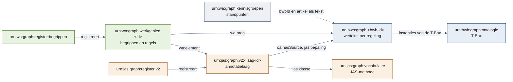
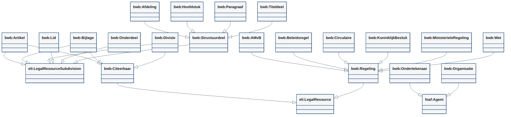
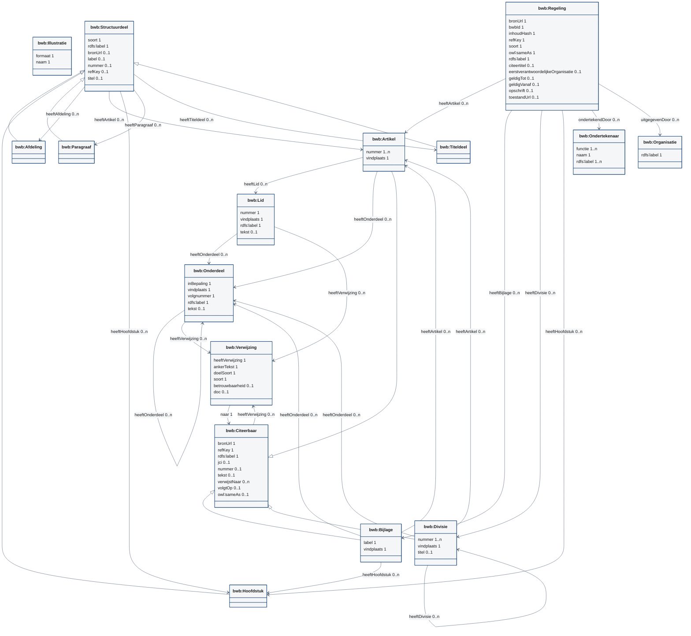
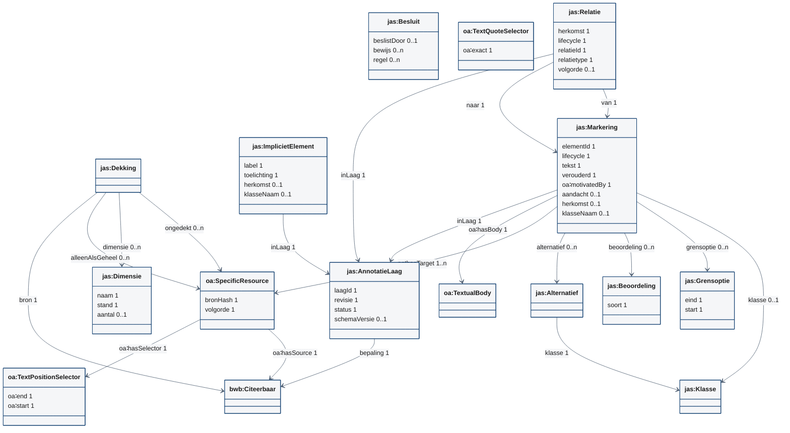
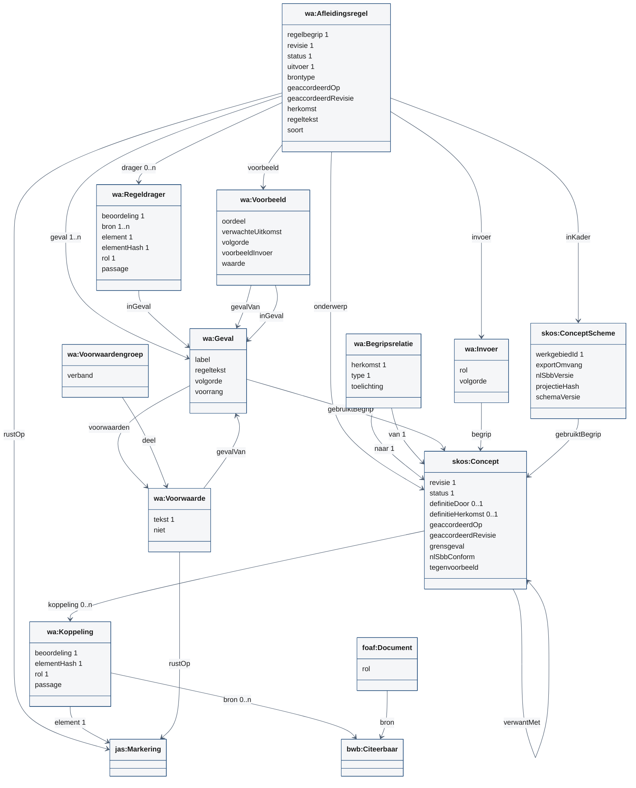
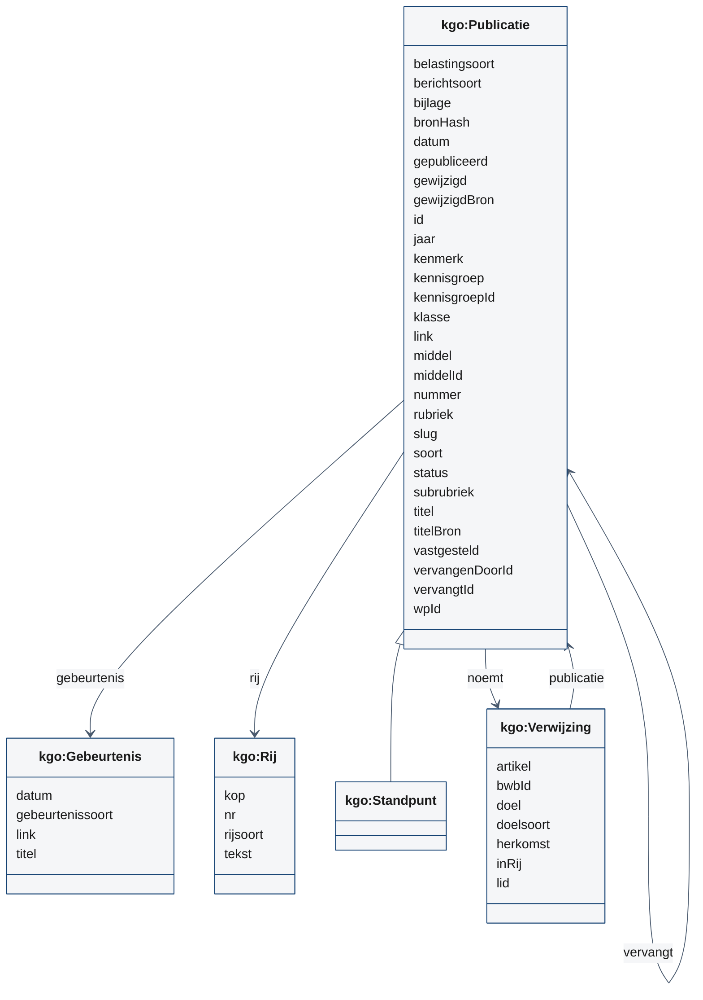

<!-- GEGENEREERD door tools/graph-qa/scripts/genereer_ontologie_docs.py; niet met de hand bewerken. -->

# Ontologie van de kennisgraaf

Gegenereerd door `tools/graph-qa/scripts/genereer_ontologie_docs.py` uit de T-Box, de SHACL-shapes en de vocabulaires; niet met de hand bewerken. Wat er in de kennisgraaf staat, in welke named graph, met welke klassen en eigenschappen, en wat daarvan formeel is vastgelegd. De wettekst is het fundament; annotaties, begrippen en regels wijzen er met een IRI naar en schrijven er nooit in.

| Ontologie | Namespace | Versie |
|---|---|---|
| Wettekst (BWB) | `urn:bwb-ns:` | 1.1.0 |
| JAS-annotatielagen | `urn:jas-ns:` | 4.0.0 |
| Begrippen en afleidingsregels | `urn:wa-ns:` | 3.0.0 |
| Kennisgroepstandpunten | `urn:wa-kg-ns:` | 1.0.0 |

Het **aantal** in de tabellen komt uit de shapes: `1` is verplicht, `0..1` optioneel en enkelvoudig, `0..n` optioneel en meervoudig, `0` verboden. Een lege cel betekent dat alleen het vocabulaire de eigenschap noemt, zonder eis. Een pijl (→) wijst naar een klasse.

## Named graphs

Elke soort inhoud staat in een eigen named graph. De pijlen zijn verwijzingen: een annotatie, begrip of regel noemt een bepaling als object van een triple, nooit als subject.

| Named graph | Inhoud | Schrijver |
|---|---|---|
| `urn:bwb:graph:<bwb-id>` | De wettekst van één regeling | BWB-importer, PUT per regeling |
| `urn:bwb:graph:ontologie` | De T-Box | BWB-importer |
| `urn:jas:graph:v2:<laag-id>` | Eén annotatielaag op één bronnode | api, na elke commit |
| `urn:jas:graph:register:v2` | Register van de lagen | api |
| `urn:jas:graph:vocabulaire` | De JAS-methode als SKOS | api |
| `urn:wa:graph:werkgebied:<id>` | Begrippenkader en afleidingsregels van één werkgebied | api, na elke commit |
| `urn:wa:graph:register:begrippen` | Register van de werkgebied-graphs | api |
| `urn:wa:graph:kennisgroepen` | Index van de kennisgroepstandpunten | BWB-importer |

## Wettekst (BWB)

De BWB-importer haalt de wettekst bij de officiële bron en schrijft per regeling één named graph. De **T-Box** zegt welke klassen en eigenschappen er zijn en hoe ze op ELI aansluiten; de **shapes** zeggen wat een node van elke klasse moet en mag hebben. De importer toetst elke graph vóór hij hem schrijft: een graph die afwijkt, vervangt nooit een bestaande. Resources staan onder `urn:bwb:` (bijvoorbeeld `urn:bwb:BWBR0004770:artikel:9:lid:1`), het vocabulaire onder `urn:bwb-ns:`: bewust disjunct.

| Vastgelegd | Waar |
|---|---|
| T-Box | `docs/ontologie/bwb-ontologie.ttl`, gegenereerd uit `tools/bwb-import/app/ontology.py` |
| Shapes | `tools/bwb-import/app/shapes/bwb-graaf.ttl`, blokkerend vóór elke PUT |
| Drift | `tools/bwb-import/tests/test_ontology.py`, `test_shacl.py` |

### Klassenhiërarchie

### Klassendiagram

### Klassen

#### `bwb:Artikel`

Wetsartikel; citeerbaar op JuriConnect-sleutel. Subklasse van `eli:LegalResourceSubdivision`, `bwb:Citeerbaar`.

| eigenschap | aantal | soort | uitleg |
|---|---|---|---|
| `bwb:nummer` | 1..n | – | Nummer binnen de ouder (artikel-/lid-/onderdeelnummer). |
| `bwb:vindplaats` | 1 | – | Leesbare plek van een bepaling binnen haar regeling ("Artikel 9, lid 1", "Artikel 9.2, onderdeel d"), uit de echte boom. |
| `bwb:heeftLid` | 0..n | → bwb:Lid | Artikel bevat lid. |
| `bwb:heeftOnderdeel` | 0..n | → bwb:Onderdeel | Bevat lijstonderdeel. |

#### `bwb:Bijlage`

Bijlage van een regeling; container (eigen artikelen/onderdelen) én tekstdrager, citeerbaar op JuriConnect-sleutel. Subklasse van `eli:LegalResourceSubdivision`, `bwb:Citeerbaar`.

| eigenschap | aantal | soort | uitleg |
|---|---|---|---|
| `bwb:label` | 1 | – | Structuurlabel uit de bron-XML. |
| `bwb:vindplaats` | 1 | – | Leesbare plek van een bepaling binnen haar regeling ("Artikel 9, lid 1", "Artikel 9.2, onderdeel d"), uit de echte boom. |
| `bwb:heeftArtikel` | 0..n | → bwb:Artikel | Bevat artikel. |
| `bwb:heeftHoofdstuk` | 0..n | → bwb:Hoofdstuk | Wet bevat hoofdstuk. |
| `bwb:heeftOnderdeel` | 0..n | → bwb:Onderdeel | Bevat lijstonderdeel. |

#### `bwb:Citeerbaar`

Tekstdeel met een eigen JuriConnect-identiteit; doel van verwijzingen. Subklasse van `eli:LegalResource`.

| eigenschap | aantal | soort | uitleg |
|---|---|---|---|
| `bwb:bronUrl` | 1 | – | Vindplaats van dit tekstdeel in de gepubliceerde toestand op wetten.overheid.nl (anker-URL, afgeleid uit het documentpad). GEEN JuriConnect-identiteit: de meeste circulaire-divisies krijgen van de BWB-redactie geen eigen jci, en er zelf een verzinnen landt stil op de hele regeling. Gebruik owl:sameAs of bwb:jci als je een citeerbare, versie-onafhankelijke sleutel nodig hebt. |
| `bwb:refKey` | 1 | xsd:string | JuriConnect-afgeleide identiteitssleutel. |
| `rdfs:label` | 1 | – |  |
| `bwb:heeftVerwijzing` | 0..n | → bwb:Verwijzing | Koppelt de gereïficeerde verwijzing aan de bron. |
| `bwb:jci` | 0..1 | patroon ^jci1\.3: | Ruwe JuriConnect-verwijzing uit de bron. |
| `bwb:nummer` | 0..1 | – | Nummer binnen de ouder (artikel-/lid-/onderdeelnummer). |
| `bwb:tekst` | 0..1 | rdf:langString @nl | Lopende tekst van het tekstdeel. |
| `bwb:verwijstNaar` | 0..n | IRI | Citatie naar een ander citeerbaar tekstdeel (open-world doel). |
| `bwb:volgtOp` | 0..1 | IRI | Documentvolgorde binnen dezelfde ouder. |
| `owl:sameAs` | 0..1 | IRI |  |

#### `bwb:Divisie`

Divisie van een circulaire/beleidsregel; container én tekstdrager. Subklasse van `eli:LegalResourceSubdivision`, `bwb:Citeerbaar`.

| eigenschap | aantal | soort | uitleg |
|---|---|---|---|
| `bwb:nummer` | 1..n | – | Nummer binnen de ouder (artikel-/lid-/onderdeelnummer). |
| `bwb:vindplaats` | 1 | – | Leesbare plek van een bepaling binnen haar regeling ("Artikel 9, lid 1", "Artikel 9.2, onderdeel d"), uit de echte boom. |
| `bwb:heeftArtikel` | 0..n | → bwb:Artikel | Bevat artikel. |
| `bwb:heeftDivisie` | 0..n | → bwb:Divisie | Bevat circulaire-divisie. |
| `bwb:heeftOnderdeel` | 0..n | → bwb:Onderdeel | Bevat lijstonderdeel. |
| `bwb:titel` | 0..1 | – | Titel van het structuurdeel of de divisie. |

#### `bwb:Illustratie`

Afbeelding (uit <plaatje>/<illustratie>) binnen een tekstdrager.

| eigenschap | aantal | soort | uitleg |
|---|---|---|---|
| `bwb:formaat` | 1 | – | Bestandsformaat van een illustratie (bv. png). |
| `bwb:naam` | 1 | – | Naam (bestandsnaam van een illustratie of naam van een persoon). |

#### `bwb:Lid`

Genummerd lid binnen een artikel. Subklasse van `eli:LegalResourceSubdivision`. Minstens één van: (bwb:tekst aanwezig) | (bwb:heeftOnderdeel aanwezig).

| eigenschap | aantal | soort | uitleg |
|---|---|---|---|
| `bwb:nummer` | 1 | – | Nummer binnen de ouder (artikel-/lid-/onderdeelnummer). |
| `bwb:vindplaats` | 1 | – | Leesbare plek van een bepaling binnen haar regeling ("Artikel 9, lid 1", "Artikel 9.2, onderdeel d"), uit de echte boom. |
| `rdfs:label` | 1 | – |  |
| `bwb:heeftOnderdeel` | 0..n | → bwb:Onderdeel | Bevat lijstonderdeel. |
| `bwb:heeftVerwijzing` | 0..n | → bwb:Verwijzing | Koppelt de gereïficeerde verwijzing aan de bron. |
| `bwb:tekst` | 0..1 | rdf:langString @nl | Lopende tekst van het tekstdeel. |

#### `bwb:Onderdeel`

Opsommings- of definitieonderdeel (<li>) binnen een lijst, of de tekst die ná een opsomming doorloopt: een ongenummerd onderdeel met bwb:label "Slottekst". Subklasse van `eli:LegalResourceSubdivision`.

| eigenschap | aantal | soort | uitleg |
|---|---|---|---|
| `bwb:inBepaling` | 1 | IRI | De bepaling waarin een onderdeel staat (lid, artikel, divisie of bijlage), uit de echte boom: de IRI van een onderdeel van een beleidsregel zegt dat niet. |
| `bwb:vindplaats` | 1 | – | Leesbare plek van een bepaling binnen haar regeling ("Artikel 9, lid 1", "Artikel 9.2, onderdeel d"), uit de echte boom. |
| `bwb:volgnummer` | 1 | xsd:integer | Plek van een onderdeel in de documentvolgorde van zijn regeling, om op te sorteren. |
| `rdfs:label` | 1 | – |  |
| `bwb:heeftOnderdeel` | 0..n | → bwb:Onderdeel | Bevat lijstonderdeel. |
| `bwb:heeftVerwijzing` | 0..n | → bwb:Verwijzing | Koppelt de gereïficeerde verwijzing aan de bron. |
| `bwb:tekst` | 0..1 | rdf:langString @nl | Lopende tekst van het tekstdeel. |

#### `bwb:Ondertekenaar`

Persoon die de regeling heeft ondertekend (functie + naam). Subklasse van `foaf:Agent`.

| eigenschap | aantal | soort | uitleg |
|---|---|---|---|
| `bwb:functie` | 1..n | – | Functie/hoedanigheid van de ondertekenaar. |
| `bwb:naam` | 1 | – | Naam (bestandsnaam van een illustratie of naam van een persoon). |
| `rdfs:label` | 1..n | – |  |

#### `bwb:Organisatie`

Verantwoordelijke organisatie/ministerie van een regeling (uit de WTI). Subklasse van `foaf:Agent`.

| eigenschap | aantal | soort | uitleg |
|---|---|---|---|
| `rdfs:label` | 1 | – |  |

#### `bwb:Regeling`

Een regeling uit het Basiswettenbestand (wet, AMvB, ministeriële regeling, beleidsregel, circulaire, …). Subklasse van `eli:LegalResource`.

| eigenschap | aantal | soort | uitleg |
|---|---|---|---|
| `bwb:bronUrl` | 1 | – | Vindplaats van dit tekstdeel in de gepubliceerde toestand op wetten.overheid.nl (anker-URL, afgeleid uit het documentpad). GEEN JuriConnect-identiteit: de meeste circulaire-divisies krijgen van de BWB-redactie geen eigen jci, en er zelf een verzinnen landt stil op de hele regeling. Gebruik owl:sameAs of bwb:jci als je een citeerbare, versie-onafhankelijke sleutel nodig hebt. |
| `bwb:bwbId` | 1 | xsd:string; patroon ^BWB[RV][0-9]+$ | Identificatie in het Basiswettenbestand. |
| `bwb:inhoudHash` | 1 | xsd:string | sha256 over de inhoud van de named graph van deze regeling: verandert bij elke andere tekst, ook zonder nieuwe toestand. |
| `bwb:refKey` | 1 | – | JuriConnect-afgeleide identiteitssleutel. |
| `bwb:soort` | 1 | – | Soort regeling of verwijzing. |
| `owl:sameAs` | 1 | IRI; patroon ^https://wetten\.overheid\.nl/ |  |
| `rdfs:label` | 1 | – |  |
| `bwb:citeertitel` | 0..1 | rdf:langString @nl | Officiële citeertitel. |
| `bwb:eerstverantwoordelijkeOrganisatie` | 0..1 | IRI | Het eerstverantwoordelijke ministerie als TOOI-URI (identifier.overheid.nl), uit de WTI-naam via het TOOI-register (`app/tooi.py`); de naam zelf staat op bwb:eerstverantwoordelijke. |
| `bwb:geldigTot` | 0..1 | xsd:date | Einde van het geldigheidsvenster. |
| `bwb:geldigVanaf` | 0..1 | xsd:date | Begin van het geldigheidsvenster van de toestand. |
| `bwb:heeftArtikel` | 0..n | → bwb:Artikel | Bevat artikel. |
| `bwb:heeftBijlage` | 0..n | → bwb:Bijlage | Regeling bevat bijlage. |
| `bwb:heeftDivisie` | 0..n | → bwb:Divisie | Bevat circulaire-divisie. |
| `bwb:heeftHoofdstuk` | 0..n | → bwb:Hoofdstuk | Wet bevat hoofdstuk. |
| `bwb:ondertekendDoor` | 0..n | → bwb:Ondertekenaar | Regeling is ondertekend door deze persoon. |
| `bwb:opschrift` | 0..1 | – | Intitulé/opschrift van de regeling. |
| `bwb:toestandUrl` | 0..1 | IRI | Identiteit van de geïmporteerde toestand (versie) op wetten.overheid.nl. |
| `bwb:uitgegevenDoor` | 0..n | → bwb:Organisatie | Verantwoordelijke organisatie/ministerie van de regeling (uit de WTI). |

#### `bwb:Structuurdeel`

Abstract structuurniveau van een wettekst (hoofdstuk, afdeling, …). Subklasse van `eli:LegalResourceSubdivision`. Geldt voor `bwb:Afdeling`, `bwb:Hoofdstuk`, `bwb:Paragraaf`, `bwb:Titeldeel`. Minstens één van: (bwb:nummer aanwezig) | (bwb:titel aanwezig).

| eigenschap | aantal | soort | uitleg |
|---|---|---|---|
| `bwb:soort` | 1 | – | Soort regeling of verwijzing. |
| `rdfs:label` | 1 | – |  |
| `bwb:bronUrl` | 0..1 | – | Vindplaats van dit tekstdeel in de gepubliceerde toestand op wetten.overheid.nl (anker-URL, afgeleid uit het documentpad). GEEN JuriConnect-identiteit: de meeste circulaire-divisies krijgen van de BWB-redactie geen eigen jci, en er zelf een verzinnen landt stil op de hele regeling. Gebruik owl:sameAs of bwb:jci als je een citeerbare, versie-onafhankelijke sleutel nodig hebt. |
| `bwb:heeftAfdeling` | 0..n | → bwb:Afdeling | Bevat afdeling. |
| `bwb:heeftArtikel` | 0..n | → bwb:Artikel | Bevat artikel. |
| `bwb:heeftHoofdstuk` | 0..n | → bwb:Hoofdstuk | Wet bevat hoofdstuk. |
| `bwb:heeftParagraaf` | 0..n | → bwb:Paragraaf | Bevat paragraaf. |
| `bwb:heeftTiteldeel` | 0..n | → bwb:Titeldeel | Bevat titeldeel. |
| `bwb:label` | 0..1 | – | Structuurlabel uit de bron-XML. |
| `bwb:nummer` | 0..1 | – | Nummer binnen de ouder (artikel-/lid-/onderdeelnummer). |
| `bwb:refKey` | 0..1 | – | JuriConnect-afgeleide identiteitssleutel. |
| `bwb:titel` | 0..1 | – | Titel van het structuurdeel of de divisie. |

#### `bwb:Verwijzing`

Gereïficeerde verwijzing met soort/doel-metadata.

| eigenschap | aantal | soort | uitleg |
|---|---|---|---|
| `^bwb:heeftVerwijzing` | 1 | – |  |
| `bwb:ankerTekst` | 1 | – | Tekst waarmee de verwijzing in de bron staat. |
| `bwb:doelSoort` | 1 | – | Niveau van het verwijsdoel (artikel/lid/…). |
| `bwb:naar` | 1 | IRI; patroon ^urn:bwb:BWB[RV][0-9]+ | Doel van de gereïficeerde verwijzing. |
| `bwb:soort` | 1 | – | Soort regeling of verwijzing. |
| `bwb:betrouwbaarheid` | 0..1 | "laag" | Betrouwbaarheid van een gedetecteerde (tekstuele) verwijzing. |
| `bwb:doc` | 0..1 | xsd:string | Ruwe jci-doc van de verwijzing. |

### Kwaliteitstoets

| ernst | bevinding |
|---|---|
| waarschuwing | 37 eigenschappen zonder eis in de shapes (alleen in het vocabulaire): `bwb:aanhef`, `bwb:achternaam`, `bwb:afkorting`, `bwb:alt`, `bwb:alternatieveTitel`, `bwb:bevatIllustratie`, `bwb:bevoegdheidVoor`, `bwb:breedte`, `bwb:bron`, `bwb:considerans`, `bwb:definieertBegrip`, `bwb:doelLabel`, `bwb:doelLid`, `bwb:doelPad`, `bwb:dossier`, `bwb:eerstverantwoordelijke`, `bwb:effect`, `bwb:grondslagVoor`, `bwb:heeftGrondslag`, `bwb:hoogte`, `bwb:inFamilie`, `bwb:inwerking`, `bwb:inwerkingtredingsbron`, `bwb:labelId`, `bwb:ondertekeningsdatum`, `bwb:opmerking`, `bwb:plaats`, `bwb:publicatiejaar`, `bwb:publicatienr`, `bwb:status`, `bwb:terugwerkendTot`, `bwb:uitgiftedatum`, `bwb:verwijzingDoor`, `bwb:verwijzingId`, `bwb:voetnoot`, `bwb:voornaam`, `bwb:wijzigingsbronnen` |

### Alle eigenschappen van de T-Box

| eigenschap | soort | bereik | ELI | uitleg |
|---|---|---|---|---|
| `bwb:aanhef` | datatype |  |  | Aanhef van de regeling. |
| `bwb:achternaam` | datatype |  |  | Achternaam van de ondertekenaar. |
| `bwb:afkorting` | datatype |  |  | Gangbare afkorting van de regeling (uit de WTI). |
| `bwb:alt` | datatype |  |  | Alternatieve tekst/bijschrift van een illustratie. |
| `bwb:alternatieveTitel` | datatype |  | `eli:title_alternative` | Niet-officiële titel van de regeling (uit de WTI). |
| `bwb:ankerTekst` | datatype |  |  | Tekst waarmee de verwijzing in de bron staat. |
| `bwb:betrouwbaarheid` | datatype |  |  | Betrouwbaarheid van een gedetecteerde (tekstuele) verwijzing. |
| `bwb:bevatIllustratie` | object | `bwb:Illustratie` |  | Tekstdrager bevat een afbeelding. |
| `bwb:bevoegdheidVoor` | object | `bwb:Regeling` |  | Regeling waarvoor dit tekstdeel de wettelijke bevoegdheid geeft (WTI). |
| `bwb:breedte` | datatype |  |  | Breedte van een illustratie (bv. 1417px). |
| `bwb:bron` | datatype |  |  | Publicatiebron (bv. Stb.2009-265). |
| `bwb:bronUrl` | object |  |  | Vindplaats van dit tekstdeel in de gepubliceerde toestand op wetten.overheid.nl (anker-URL, afgeleid uit het documentpad). GEEN JuriConnect-identiteit: de meeste circulaire-divisies krijgen van de BWB-redactie geen eigen jci, en er zelf een verzinnen landt stil op de hele regeling. Gebruik owl:sameAs of bwb:jci als je een citeerbare, versie-onafhankelijke sleutel nodig hebt. |
| `bwb:bwbId` | datatype | `xsd:string` |  | Identificatie in het Basiswettenbestand. |
| `bwb:citeertitel` | datatype |  | `eli:title` | Officiële citeertitel. |
| `bwb:considerans` | datatype |  |  | Considerans (overwegingen) van de regeling. |
| `bwb:definieertBegrip` | datatype |  |  | Begrip dat in dit tekstdeel wordt gedefinieerd. |
| `bwb:doc` | datatype | `xsd:string` |  | Ruwe jci-doc van de verwijzing. |
| `bwb:doelLabel` | datatype |  |  | Leesbare naam voor een verwijsdoel dat (nog) niet is geïmporteerd. Bewust GEEN rdfs:label: elke wet staat in een eigen named graph, dus een fallback-label op rdfs:label komt naast het echte label van dat tekstdeel te staan zodra die wet wél wordt geïmporteerd — en dan levert elke query die een label ophaalt dubbele rijen. Lees dit als COALESCE(rdfs:label, bwb:doelLabel). |
| `bwb:doelLid` | datatype |  |  | Lidnummer dat de verwijzing noemt, ook als het doel op het artikel is blijven staan. |
| `bwb:doelPad` | datatype |  |  | bwb-ng-variabel-deel van het verwijsdoel. |
| `bwb:doelSoort` | datatype |  |  | Niveau van het verwijsdoel (artikel/lid/…). |
| `bwb:dossier` | datatype |  |  | Kamerdossiernummer. Op de regeling: het dossier van de oorspronkelijke wet. Op een tekstdeel: het dossier (of de dossiers) van de wet die het zijn huidige inhoud gaf, uit zijn eigen brondata. |
| `bwb:eerstverantwoordelijke` | datatype |  |  | Eerstverantwoordelijk ministerie (uit de WTI). |
| `bwb:eerstverantwoordelijkeOrganisatie` | object |  |  | Het eerstverantwoordelijke ministerie als TOOI-URI (identifier.overheid.nl), uit de WTI-naam via het TOOI-register (`app/tooi.py`); de naam zelf staat op bwb:eerstverantwoordelijke. |
| `bwb:effect` | datatype |  |  | Effect van de laatste wijziging. |
| `bwb:formaat` | datatype |  |  | Bestandsformaat van een illustratie (bv. png). |
| `bwb:functie` | datatype |  |  | Functie/hoedanigheid van de ondertekenaar. |
| `bwb:geldigTot` | datatype | `xsd:date` |  | Einde van het geldigheidsvenster. |
| `bwb:geldigVanaf` | datatype | `xsd:date` | `eli:first_date_entry_in_force` | Begin van het geldigheidsvenster van de toestand. |
| `bwb:grondslagVoor` | object | `bwb:Regeling` |  | Regeling die (mede) op dit tekstdeel is gebaseerd (WTI-regelingelement). |
| `bwb:heeftAfdeling` | object | `bwb:Afdeling` | `eli:has_part` | Bevat afdeling. |
| `bwb:heeftArtikel` | object | `bwb:Artikel` | `eli:has_part` | Bevat artikel. |
| `bwb:heeftBijlage` | object | `bwb:Bijlage` | `eli:has_part` | Regeling bevat bijlage. |
| `bwb:heeftDivisie` | object | `bwb:Divisie` | `eli:has_part` | Bevat circulaire-divisie. |
| `bwb:heeftGrondslag` | object | `bwb:Regeling` | `eli:based_on` | Regeling waarop deze regeling (mede) is gebaseerd (uit de WTI). |
| `bwb:heeftHoofdstuk` | object | `bwb:Hoofdstuk` | `eli:has_part` | Wet bevat hoofdstuk. |
| `bwb:heeftLid` | object | `bwb:Lid` | `eli:has_part` | Artikel bevat lid. |
| `bwb:heeftOnderdeel` | object | `bwb:Onderdeel` | `eli:has_part` | Bevat lijstonderdeel. |
| `bwb:heeftParagraaf` | object | `bwb:Paragraaf` | `eli:has_part` | Bevat paragraaf. |
| `bwb:heeftTiteldeel` | object | `bwb:Titeldeel` | `eli:has_part` | Bevat titeldeel. |
| `bwb:heeftVerwijzing` | object | `bwb:Verwijzing` |  | Koppelt de gereïficeerde verwijzing aan de bron. |
| `bwb:hoogte` | datatype |  |  | Hoogte van een illustratie (bv. 364px). |
| `bwb:inBepaling` | object |  |  | De bepaling waarin een onderdeel staat (lid, artikel, divisie of bijlage), uit de echte boom: de IRI van een onderdeel van een beleidsregel zegt dat niet. |
| `bwb:inFamilie` | object | `bwb:Regeling` |  | Verwante regeling binnen dezelfde wetsfamilie (uit de WTI). |
| `bwb:inhoudHash` | datatype | `xsd:string` |  | sha256 over de inhoud van de named graph van deze regeling: verandert bij elke andere tekst, ook zonder nieuwe toestand. |
| `bwb:inwerking` | datatype | `xsd:date` |  | Datum inwerkingtreding van dit tekstdeel. |
| `bwb:inwerkingtredingsbron` | datatype |  |  | Stb-bron van het inwerkingtredingsbesluit van de laatste wijziging van dit tekstdeel. |
| `bwb:jci` | datatype | `xsd:string` |  | Ruwe JuriConnect-verwijzing uit de bron. |
| `bwb:label` | datatype |  |  | Structuurlabel uit de bron-XML. |
| `bwb:labelId` | datatype | `xsd:string` |  | WTI-koppelsleutel (label-id uit de bron-XML). |
| `bwb:naam` | datatype |  |  | Naam (bestandsnaam van een illustratie of naam van een persoon). |
| `bwb:naar` | object | `bwb:Citeerbaar` |  | Doel van de gereïficeerde verwijzing. |
| `bwb:nummer` | datatype |  |  | Nummer binnen de ouder (artikel-/lid-/onderdeelnummer). |
| `bwb:ondertekendDoor` | object | `bwb:Ondertekenaar` | `eli:passed_by` | Regeling is ondertekend door deze persoon. |
| `bwb:ondertekeningsdatum` | datatype | `xsd:date` | `eli:date_document` | Datum van ondertekening. |
| `bwb:opmerking` | datatype |  |  | Redactionele opmerking bij dit tekstdeel uit de brondata (vaak: waar het overgangsrecht staat). |
| `bwb:opschrift` | datatype |  | `eli:title_alternative` | Intitulé/opschrift van de regeling. |
| `bwb:plaats` | datatype |  |  | Plaats van ondertekening. |
| `bwb:publicatiejaar` | datatype | `xsd:gYear` |  | Jaar van de oorspronkelijke publicatie. |
| `bwb:publicatienr` | datatype |  |  | Nummer van de oorspronkelijke publicatie. |
| `bwb:refKey` | datatype | `xsd:string` |  | JuriConnect-afgeleide identiteitssleutel. |
| `bwb:soort` | datatype |  |  | Soort regeling of verwijzing. |
| `bwb:status` | datatype |  |  | Redactionele status. |
| `bwb:tekst` | datatype |  |  | Lopende tekst van het tekstdeel. |
| `bwb:terugwerkendTot` | datatype | `xsd:date` |  | Retroactieve ingangsdatum van de wijziging die dit tekstdeel zijn huidige inhoud gaf. |
| `bwb:titel` | datatype |  |  | Titel van het structuurdeel of de divisie. |
| `bwb:toestandUrl` | object |  |  | Identiteit van de geïmporteerde toestand (versie) op wetten.overheid.nl. |
| `bwb:uitgegevenDoor` | object | `bwb:Organisatie` | `eli:responsibility_of` | Verantwoordelijke organisatie/ministerie van de regeling (uit de WTI). |
| `bwb:uitgiftedatum` | datatype | `xsd:date` | `eli:date_publication` | Datum van uitgifte. |
| `bwb:verwijstNaar` | object | `bwb:Citeerbaar` | `eli:cites` | Citatie naar een ander citeerbaar tekstdeel (open-world doel). |
| `bwb:verwijzingDoor` | object | `bwb:Regeling` |  | Regeling die naar dit tekstdeel verwijst (WTI-regelingelement). |
| `bwb:verwijzingId` | datatype | `xsd:string` |  | Bron-id van de verwijzing. |
| `bwb:vindplaats` | datatype | `xsd:string` |  | Leesbare plek van een bepaling binnen haar regeling ("Artikel 9, lid 1", "Artikel 9.2, onderdeel d"), uit de echte boom. |
| `bwb:voetnoot` | datatype |  |  | Voetnoot bij het tekstdeel. |
| `bwb:volgnummer` | datatype | `xsd:integer` |  | Plek van een onderdeel in de documentvolgorde van zijn regeling, om op te sorteren. |
| `bwb:volgtOp` | object |  |  | Documentvolgorde binnen dezelfde ouder. |
| `bwb:voornaam` | datatype |  |  | Voornaam van de ondertekenaar. |
| `bwb:wijzigingsbronnen` | datatype |  |  | Stb-bron van een wijziging (<juncto>). |

## JAS-annotatielagen

Een markering is een W3C Web Annotation (`oa:Annotation`) op een bronnode: het doel met positie en letterlijk citaat, de JAS-klasse, de levenscyclus en het herkomstspoor. Eén laag hoort bij één bronnode en staat in een eigen named graph. Postgres is de waarheid; de api projecteert. Personen en vrije commentaartekst staan er nooit in. Er is bewust **geen T-Box**: met `rdfsplus-optimized` zou een `rdfs:range` op een property naar een wetsnode triples met de wet als subject laten afleiden. De shapes zijn verdeeld in de groepen *RDF-structuur* en *JAS-model*.

| Vastgelegd | Waar |
|---|---|
| Vocabulaire | `api/app/vocabulaire/jas-vocabulaire.ttl` (SKOS: klassen, begrippen, regels, codes), gegenereerd door `tools/graph-qa/scripts/genereer_jas_vocabulaire.py` |
| Shapes | `api/app/shapes/jas-v2.ttl`, diagnostisch (tests, CI, graafcontrole) |
| Uitleg | `docs/wetsanalyse-workbench/jas-annotatie-ontologie.md` |

### Klassendiagram

**De vocabulaire** (`urn:jas:graph:vocabulaire`) bevat de dertien klassen (Afleidingsregel, Brondefinitie, Delegatiebevoegdheid en delegatie-invulling, Operator, Parameter en parameterwaarde, Plaatsaanduiding, Rechtsbetrekking, Rechtsfeit, Rechtsobject, Rechtssubject, Tijdsaanduiding, Variabele en variabelewaarde, Voorwaarde) als `skos:Concept`, met de typen `jas:Begrip`, `jas:Besluitwijze`, `jas:Classifiercode`, `jas:Detectiecode`, `jas:Detectorregel`, `jas:Klasse`, `jas:Methoderegel`, `jas:Relatieregel`, `jas:Relatietype`, `jas:Resolutieregel`, `jas:Subtype`, `jas:Twijfelreden`, `jas:Validatiecode`.

### Klassen

#### `jas:Alternatief`

| eigenschap | aantal | soort | groep | uitleg |
|---|---|---|---|---|
| `jas:klasse` | 1 | IRI; patroon ^urn:jas-ns:klasse: | JasModel |  |

#### `jas:AnnotatieLaag`

Fout (SPARQL-regel) als: “Een subject onder urn:bwb: in een annotatielaag – een annotatie zou als wettekst lezen.”

| eigenschap | aantal | soort | groep | uitleg |
|---|---|---|---|---|
| `jas:bepaling` | 1 | IRI; patroon ^urn:bwb:BWB[RV][0-9]+ | JasModel |  |
| `jas:laagId` | 1 | xsd:string | RdfStructuur |  |
| `jas:revisie` | 1 | xsd:integer; ≥ 0 | RdfStructuur |  |
| `jas:status` | 1 | "in_review" · "geaccordeerd" · "gepromoveerd" | JasModel |  |
| `jas:schemaVersie` | 0..1 | = 4 | RdfStructuur |  |

#### `jas:Beoordeling`

| eigenschap | aantal | soort | groep | uitleg |
|---|---|---|---|---|
| `jas:soort` | 1 | "markering" · "approve" · "reject" · "heropen" · "comment" · "edit" · "grens" | JasModel |  |
| `jas:actor` | 0 | – | JasModel | Een beoordeling in de graaf draagt geen persoon. |
| `jas:commentaar` | 0 | – | JasModel |  |

#### `jas:Besluit`

| eigenschap | aantal | soort | groep | uitleg |
|---|---|---|---|---|
| `jas:beslistDoor` | 0..1 | IRI; patroon ^urn:jas-ns:besluit: | JasModel |  |
| `jas:bewijs` | 0..n | IRI; patroon ^urn:jas-ns:code: | JasModel |  |
| `jas:regel` | 0..n | IRI; patroon ^urn:jas-ns:regel: | JasModel |  |

#### `jas:Dekking`

| eigenschap | aantal | soort | groep | uitleg |
|---|---|---|---|---|
| `jas:bron` | 1 | IRI; patroon ^urn:bwb:BWB[RV][0-9]+ | JasModel |  |
| `jas:alleenAlsGeheel` | 0..n | → oa:SpecificResource | RdfStructuur |  |
| `jas:dimensie` | 0..n | → jas:Dimensie | RdfStructuur |  |
| `jas:ongedekt` | 0..n | → oa:SpecificResource | RdfStructuur |  |

#### `jas:Dimensie`

| eigenschap | aantal | soort | groep | uitleg |
|---|---|---|---|---|
| `jas:naam` | 1 | – | JasModel |  |
| `jas:stand` | 1 | "uitgevoerd" · "gedeeltelijk" · "overgeslagen" | JasModel |  |
| `jas:aantal` | 0..1 | xsd:integer; ≥ 0 | JasModel |  |

#### `jas:Grensoptie`

| eigenschap | aantal | soort | uitleg |
|---|---|---|---|
| `jas:eind` | 1 | xsd:integer |  |
| `jas:start` | 1 | xsd:integer; ≥ 0; < jas:eind |  |

#### `jas:ImplicietElement`

| eigenschap | aantal | soort | groep | uitleg |
|---|---|---|---|---|
| `jas:inLaag` | 1 | → jas:AnnotatieLaag | RdfStructuur |  |
| `jas:label` | 1 | xsd:string; lengte ≥ 1 | RdfStructuur |  |
| `jas:toelichting` | 1 | xsd:string; lengte ≥ 1 | RdfStructuur |  |
| `jas:herkomst` | 0..1 | = "mens" | JasModel |  |
| `jas:klasseNaam` | 0..1 | = "Rechtssubject" | JasModel |  |
| `oa:hasTarget` | 0 | – | JasModel |  |

#### `jas:Markering`

Precies één van: (oa:motivatedBy = oa:classifying en jas:klasse aanwezig en jas:klasseNaam aanwezig) | (oa:motivatedBy = oa:questioning en geen jas:klasse en geen jas:klasseNaam en jas:alternatief aanwezig).

| eigenschap | aantal | soort | groep | uitleg |
|---|---|---|---|---|
| `jas:elementId` | 1 | xsd:string; lengte ≥ 1 | RdfStructuur |  |
| `jas:inLaag` | 1 | → jas:AnnotatieLaag | RdfStructuur |  |
| `jas:lifecycle` | 1 | "voorgesteld" · "human_approved" · "edited" · "rejected" · "published" · "reused" · "vervangen" | JasModel |  |
| `jas:tekst` | 1 | xsd:string; lengte ≥ 1 | RdfStructuur |  |
| `jas:verouderd` | 1 | xsd:boolean | RdfStructuur |  |
| `oa:hasBody` | 1 | → oa:TextualBody (gekwalificeerd) | RdfStructuur |  |
| `oa:hasTarget` | 1..n | → oa:SpecificResource | RdfStructuur |  |
| `oa:motivatedBy` | 1 | oa:classifying · oa:questioning | RdfStructuur |  |
| `jas:aandacht` | 0..1 | "groen" · "geel" · "rood" | JasModel |  |
| `jas:alternatief` | 0..n | → jas:Alternatief | RdfStructuur |  |
| `jas:beoordeling` | 0..n | → jas:Beoordeling | RdfStructuur |  |
| `jas:grensoptie` | 0..n | → jas:Grensoptie | RdfStructuur |  |
| `jas:herkomst` | 0..1 | "agent" · "mens" · "" | JasModel |  |
| `jas:klasse` | 0..1 | IRI; patroon ^urn:jas-ns:klasse: | JasModel |  |
| `jas:klasseNaam` | 0..1 | "Rechtssubject" · "Rechtsobject" · "Rechtsbetrekking" · "Rechtsfeit" · "Voorwaarde" · "Afleidingsregel" · "Variabele en variabelewaarde" · "Parameter en parameterwaarde" · "Operator" · "Tijdsaanduiding" · "Plaatsaanduiding" · "Delegatiebevoegdheid en delegatie-invulling" · "Brondefinitie" | JasModel |  |

#### `jas:Relatie`

| eigenschap | aantal | soort | groep | uitleg |
|---|---|---|---|---|
| `jas:herkomst` | 1 | "agent" · "mens" | JasModel |  |
| `jas:inLaag` | 1 | → jas:AnnotatieLaag | RdfStructuur |  |
| `jas:lifecycle` | 1 | "voorgesteld" · "human_approved" · "edited" · "rejected" · "published" | JasModel |  |
| `jas:naar` | 1 | IRI; patroon ^urn:jas:(element\|impliciet): | RdfStructuur |  |
| `jas:relatieId` | 1 | xsd:string; patroon ^R[0-9a-f]{16}$ | RdfStructuur |  |
| `jas:relatietype` | 1 | IRI; patroon ^urn:jas-ns:relatie:[a-z_]+$ | JasModel |  |
| `jas:van` | 1 | IRI; patroon ^urn:jas:(element\|impliciet): | RdfStructuur |  |
| `jas:volgorde` | 0..1 | xsd:integer; ≥ 1 | RdfStructuur |  |

#### `oa:SpecificResource`

| eigenschap | aantal | soort | groep | uitleg |
|---|---|---|---|---|
| `jas:bronHash` | 1 | xsd:string; patroon ^[0-9a-f]{64}$ | JasModel |  |
| `jas:volgorde` | 1 | xsd:integer | RdfStructuur |  |
| `oa:hasSelector` | 1 | → oa:TextPositionSelector (gekwalificeerd); → oa:TextQuoteSelector (gekwalificeerd) | RdfStructuur |  |
| `oa:hasSource` | 1 | IRI; patroon ^urn:bwb:BWB[RV][0-9]+ | JasModel |  |

#### `oa:TextPositionSelector`

| eigenschap | aantal | soort | uitleg |
|---|---|---|---|
| `oa:end` | 1 | xsd:integer |  |
| `oa:start` | 1 | xsd:integer; ≥ 0; < oa:end |  |

#### `oa:TextQuoteSelector`

| eigenschap | aantal | soort | uitleg |
|---|---|---|---|
| `oa:exact` | 1 | xsd:string; lengte ≥ 1 |  |

### Kwaliteitstoets

Geen bevindingen.

## Begrippen en afleidingsregels

Per werkgebied staat er één named graph met het begrippenkader (`skos:ConceptScheme`, volgens NL-SBB) en de afleidingsregels. Een begrip rust op de passages die het dragen: elke koppeling wijst naar een markering met haar bewijsstand, en via die markering naar de bepaling. Een regel loopt naar de wettekst via zijn dragers. Begrippen zijn analyse-uitkomsten, geen wettelijke definities. Het NL-SBB-profiel (`api/app/shapes/nl-sbb-1.0.0.ttl`, Geonovum, CC-BY 4.0; herkomst in `api/app/shapes/BRON.md`) staat hier niet in: de tabellen geven alleen de eigen eisen. Het vocabulaire `wa-vocabulaire.ttl` is **alleen documentatie** en wordt niet in GraphDB geladen.

| Vastgelegd | Waar |
|---|---|
| Vocabulaire | `docs/ontologie/wa-vocabulaire.ttl`, alleen documentatie |
| Shapes | NL-SBB 1.0.0 (`api/app/shapes/nl-sbb-1.0.0.ttl`) en `begrippen-wa.ttl`, `regels-wa.ttl`; diagnostisch (conformiteit) |
| Uitleg | `api/CLAUDE.md` §Begrippen naar de kennisgraaf, `docs/architectuur/adr-003-nl-sbb-begrippencontract.md` |

### Klassendiagram

### Klassen

#### `wa:Afleidingsregel`

Een regel die één begrip afleidt uit invoerbegrippen, in één of meer gevallen (activiteit 3b). Fout (SPARQL-regel) als: “Een geaccordeerde regel mist het tijdstip of de revisie van het accorderen.” Fout (SPARQL-regel) als: “Een geldende regel rust op geen grondslag die niet is afgewezen.”

| eigenschap | aantal | soort | uitleg |
|---|---|---|---|
| `wa:geval` | 1..n | → wa:Geval | Een regel heeft ten minste één geval. |
| `wa:regelbegrip` | 1 | – | Een regel heeft één regelbegrip. |
| `wa:revisie` | 1 | xsd:integer; ≥ 1 | Een regel heeft precies één revisie (≥ 1). |
| `wa:status` | 1 | "concept" · "geaccordeerd" · "geaccordeerd_als_beleidsregel" · "afgewezen" · "vervangen" | Een regel heeft precies één status. |
| `wa:uitvoer` | 1 | – | Een regel leidt precies één begrip af. |
| `wa:drager` | 0..n | → wa:Regeldrager | Een drager van de regel: de koppeling met een markering. |
| `wa:brontype` |  | – | Waar de regel op rust, standaard wet. |
| `wa:geaccordeerdOp` |  | xsd:dateTime | Moment van accorderen. |
| `wa:geaccordeerdRevisie` |  | – | De revisie die geaccordeerd is. |
| `wa:herkomst` |  | – | Wie de relatie of regel voorstelde: lex, analist of systeem. |
| `wa:inKader` |  | → skos:ConceptScheme | Het begrippenkader van het werkgebied waarin de regel staat. |
| `wa:invoer` |  | → wa:Invoer | Een invoerbegrip van de regel. |
| `wa:onderwerp` |  | → skos:Concept | Het begrip waarover de regel iets afleidt. |
| `wa:regeltekst` |  | rdf:langString | De afgeleide regeltekst van de regel of het geval. |
| `wa:rustOp` |  | → jas:Markering | De markeringen waarop een voorwaarde of regel rust. |
| `wa:soort` |  | – | Soort afleidingsregel. |
| `wa:voorbeeld` |  | → wa:Voorbeeld | Een uitgewerkt voorbeeld bij de regel. |

#### `wa:Begripsrelatie`

Een getypeerde relatie tussen twee begrippen, met herkomst. Naast deze knoop staat de relatie ook als directe triple (wa:kwalificeert, wa:omvat, …).

| eigenschap | aantal | soort | uitleg |
|---|---|---|---|
| `wa:herkomst` | 1 | "lex" · "analist" · "systeem" | Wie de relatie of regel voorstelde: lex, analist of systeem. |
| `wa:naar` | 1 | → skos:Concept | Eindpunt van een begripsrelatie. |
| `wa:type` | 1 | "kwalificatie" · "inclusie" · "uitsluiting" · "hierarchie" · "verwant" · "opvolging" | kwalificatie, inclusie, uitsluiting, hierarchie, verwant of opvolging. |
| `wa:van` | 1 | → skos:Concept | Beginpunt van een begripsrelatie. |
| `wa:toelichting` |  | – | Toelichting bij een begripsrelatie. |

#### `wa:Geval`

Eén geval van een afleidingsregel, met zijn voorwaarden en voorrang.

| eigenschap | aantal | soort | uitleg |
|---|---|---|---|
| `wa:gebruiktBegrip` |  | → skos:Concept | Een begrip dat het kader of een geval gebruikt zonder het te bevatten (een generiek begrip, ADR-006). |
| `wa:label` |  | – | Label van een geval. |
| `wa:regeltekst` |  | rdf:langString | De afgeleide regeltekst van de regel of het geval. |
| `wa:volgorde` |  | xsd:integer | Volgnummer binnen de ouder, om op te sorteren. |
| `wa:voorrang` |  | xsd:integer | Voorrang van een geval boven andere gevallen. |
| `wa:voorwaarden` |  | → wa:Voorwaarde, → wa:Voorwaardengroep | De voorwaarde of voorwaardengroep van een geval. |

#### `wa:Invoer`

Een invoerbegrip van een afleidingsregel, met rol en volgorde.

| eigenschap | aantal | soort | uitleg |
|---|---|---|---|
| `wa:begrip` |  | → skos:Concept | Het begrip van een invoer of van een waarde in een voorbeeld. |
| `wa:rol` |  | – | Rol van een koppeling (duiding, afgeleid, definitie, context), een drager (grondslag, voorwaarde, invoer, uitvoer, tijd, context), een invoer, of een brondocument (definitieonderbouwing). |
| `wa:volgorde` |  | xsd:integer | Volgnummer binnen de ouder, om op te sorteren. |

#### `wa:Koppeling`

Verbindt een begrip met een annotatie-element (markering) dat het begrip draagt, met rol, beoordeling en bewijsstand.

| eigenschap | aantal | soort | uitleg |
|---|---|---|---|
| `wa:beoordeling` | 1 | "open" · "akkoord" · "afgewezen" | open, akkoord of afgewezen. |
| `wa:element` | 1 | IRI; patroon ^urn:jas:element: | Een koppeling wijst naar precies één annotatie-element. |
| `wa:elementHash` | 1 | xsd:string; lengte ≥ 1 | Een koppeling draagt haar bewijsstand (element-hash). |
| `wa:rol` | 1 | "duiding" · "afgeleid" · "definitie" · "context" | Rol van een koppeling (duiding, afgeleid, definitie, context), een drager (grondslag, voorwaarde, invoer, uitvoer, tijd, context), een invoer, of een brondocument (definitieonderbouwing). |
| `wa:bron` | 0..n | IRI; patroon ^urn:bwb:BWB[RV][0-9]+ | De bronnode in de wettekst (urn:bwb:…), altijd als object. |
| `wa:passage` |  | – | Het letterlijke fragment van de markering. |

#### `wa:Regeldrager`

Verbindt een afleidingsregel met de markering waarop een deel ervan rust (grondslag, voorwaarde, invoer, uitvoer, tijd, context).

| eigenschap | aantal | soort | uitleg |
|---|---|---|---|
| `wa:beoordeling` | 1 | "open" · "akkoord" · "afgewezen" | open, akkoord of afgewezen. |
| `wa:bron` | 1..n | IRI | Een drager noemt de bronnode van haar markering. |
| `wa:element` | 1 | IRI | Een drager wijst naar precies één markering. |
| `wa:elementHash` | 1 | – | Een drager draagt de bewijsstand van haar markering. |
| `wa:rol` | 1 | "grondslag" · "voorwaarde" · "invoer" · "uitvoer" · "tijd" · "context" | Rol van een koppeling (duiding, afgeleid, definitie, context), een drager (grondslag, voorwaarde, invoer, uitvoer, tijd, context), een invoer, of een brondocument (definitieonderbouwing). |
| `wa:inGeval` |  | → wa:Geval | Het geval van deze regel waar een voorbeeld of drager bij hoort. |
| `wa:passage` |  | – | Het letterlijke fragment van de markering. |

#### `wa:Voorbeeld`

Een uitgewerkt voorbeeld bij een regel: invoer, verwachte uitkomst en oordeel.

| eigenschap | aantal | soort | uitleg |
|---|---|---|---|
| `wa:gevalVan` |  | → wa:Geval | Het geval van een andere regel waarnaar een voorwaarde of voorbeeld verwijst. |
| `wa:inGeval` |  | → wa:Geval | Het geval van deze regel waar een voorbeeld of drager bij hoort. |
| `wa:oordeel` |  | – | Oordeel over het voorbeeld (bijvoorbeeld open of akkoord). |
| `wa:verwachteUitkomst` |  | rdf:langString | Wat de regel bij deze invoer moet opleveren. |
| `wa:volgorde` |  | xsd:integer | Volgnummer binnen de ouder, om op te sorteren. |
| `wa:voorbeeldInvoer` |  | rdf:langString | De invoer van het voorbeeld als tekst. |
| `wa:waarde` |  | – | Op een voorbeeld: een knoop met wa:begrip en wa:waarde; op die knoop: de waarde zelf als literal. |

#### `wa:Voorwaarde`

Een enkelvoudige voorwaarde: tekst, rustend op markeringen of verwijzend naar het geval van een andere regel. Waarschuwing (SPARQL-regel) als: “Een voorwaarde rust op geen markering en verwijst naar geen geval van een andere regel.”

| eigenschap | aantal | soort | uitleg |
|---|---|---|---|
| `wa:tekst` | 1 | – | De tekst van een voorwaarde. |
| `wa:gevalVan` |  | → wa:Geval | Het geval van een andere regel waarnaar een voorwaarde of voorbeeld verwijst. |
| `wa:niet` |  | xsd:boolean | De voorwaarde is ontkend. |
| `wa:rustOp` |  | → jas:Markering | De markeringen waarop een voorwaarde of regel rust. |

#### `wa:Voorwaardengroep`

Een groep voorwaarden die alle of één van alle moeten gelden.

| eigenschap | aantal | soort | uitleg |
|---|---|---|---|
| `wa:deel` |  | → wa:Voorwaarde, → wa:Voorwaardengroep | Een voorwaarde of groep binnen een voorwaardengroep. |
| `wa:verband` |  | – | alle of een_van. |

#### `foaf:Document`

| eigenschap | aantal | soort | uitleg |
|---|---|---|---|
| `wa:bron` |  | → bwb:Citeerbaar | De bronnode in de wettekst (urn:bwb:…), altijd als object. |
| `wa:rol` |  | – | Rol van een koppeling (duiding, afgeleid, definitie, context), een drager (grondslag, voorwaarde, invoer, uitvoer, tijd, context), een invoer, of een brondocument (definitieonderbouwing). |

#### `skos:Concept`

Fout (SPARQL-regel) als: “De definitie heeft geen herkomst (letterlijk, samengesteld of geformuleerd).” Fout (SPARQL-regel) als: “Een begrip met een dragende passage heeft geen bron (dct:source).” Fout (SPARQL-regel) als: “Een geaccordeerd begrip mist het tijdstip of de revisie van het accorderen.”

| eigenschap | aantal | soort | uitleg |
|---|---|---|---|
| `wa:revisie` | 1 | xsd:integer; ≥ 1 | Een begrip heeft precies één revisie (≥ 1). |
| `wa:status` | 1 | "concept" · "geaccordeerd" · "vervangen" | Een begrip heeft precies één status: concept, geaccordeerd of vervangen. |
| `wa:definitieDoor` | 0..1 | "analist" · "lex" | Wie de definitie schreef: analist of lex. |
| `wa:definitieHerkomst` | 0..1 | "letterlijk" · "samengesteld" · "geformuleerd" | letterlijk, samengesteld of geformuleerd. |
| `wa:koppeling` | 0..n | → wa:Koppeling | Een passage die het begrip draagt of in context plaatst. |
| `wa:geaccordeerdOp` |  | xsd:dateTime | Moment van accorderen. |
| `wa:geaccordeerdRevisie` |  | – | De revisie die geaccordeerd is. |
| `wa:grensgeval` |  | – | Een voorbeeld waarvan onzeker is of het onder het begrip valt. |
| `wa:heeftSoort` |  | → skos:Concept | Directe triple van een hiërarchie: van de bredere term naar de soort. Daarnaast skos:broader en isothes:broaderGeneric in omgekeerde richting. |
| `wa:kwalificeert` |  | → skos:Concept | Directe triple van een akkoord bevonden kwalificatie. |
| `wa:nlSbbConform` |  | xsd:boolean | Alleen in de Turtle-export: of het begrip aan het NL-SBB-profiel voldoet. |
| `wa:omvat` |  | → skos:Concept | Directe triple van een akkoord bevonden inclusie. |
| `wa:omvatNiet` |  | → skos:Concept | Directe triple van een akkoord bevonden uitsluiting. |
| `wa:tegenvoorbeeld` |  | – | Een voorbeeld dat buiten het begrip valt (skos:example is alleen voor wat erbinnen valt). |
| `wa:verwantMet` |  | → skos:Concept | Directe triple van een verwantschap; daarnaast skos:related in beide richtingen. |

#### `skos:ConceptScheme`

Fout (SPARQL-regel) als: “Een subject onder urn:bwb: in een begrippengraph – een begrip zou als wettekst lezen.”

| eigenschap | aantal | soort | uitleg |
|---|---|---|---|
| `wa:werkgebiedId` | 1 | xsd:string | Id van het werkgebied, op het kader en op de registerregel. |
| `wa:exportOmvang` |  | – | Alleen in de Turtle-export: alle begrippen of alleen geaccordeerde. |
| `wa:gebruiktBegrip` |  | → skos:Concept | Een begrip dat het kader of een geval gebruikt zonder het te bevatten (een generiek begrip, ADR-006). |
| `wa:nlSbbVersie` |  | – | Alleen in de Turtle-export: de versie van het NL-SBB-profiel. |
| `wa:projectieHash` |  | xsd:string | Hash van de Postgres-stand waaruit de graph is gebouwd. |
| `wa:schemaVersie` |  | xsd:integer | Versie van de projectie; een andere waarde laat de reconcile-lus alles opnieuw projecteren. |

### Kwaliteitstoets

| ernst | bevinding |
|---|---|
| waarschuwing | 40 eigenschappen zonder eis in de shapes (alleen in het vocabulaire): `wa:begrip`, `wa:brontype`, `wa:deel`, `wa:exportOmvang`, `wa:geaccordeerdOp`, `wa:geaccordeerdRevisie`, `wa:gebruiktBegrip`, `wa:gevalVan`, `wa:grensgeval`, `wa:heeftSoort`, `wa:inGeval`, `wa:inGraaf`, `wa:inKader`, `wa:invoer`, `wa:kwalificeert`, `wa:label`, `wa:niet`, `wa:nlSbbConform`, `wa:nlSbbVersie`, `wa:omvat`, `wa:omvatNiet`, `wa:onderwerp`, `wa:oordeel`, `wa:passage`, `wa:projectieHash`, `wa:regeltekst`, `wa:rustOp`, `wa:schemaVersie`, `wa:soort`, `wa:tegenvoorbeeld`, `wa:toelichting`, `wa:verband`, `wa:verwachteUitkomst`, `wa:verwantMet`, `wa:volgorde`, `wa:voorbeeld`, `wa:voorbeeldInvoer`, `wa:voorrang`, `wa:voorwaarden`, `wa:waarde` |

## Kennisgroepstandpunten

Een index van de openbaar gepubliceerde standpunten van de kennisgroepen van de Belastingdienst. De graaf weet *dat* een standpunt over een bepaling gaat en *waar* het staat; de leestool van Lex haalt de inhoud. De index staat los van de wet: geen subject onder `urn:bwb:` en geen `bwb:`-typen, en een bepaling staat erin als tekst (BWB-id, artikel, lid), niet als IRI. Er zijn **geen shapes**: de kolom *aantal* is daarom leeg. Rij, verwijzing en gebeurtenis zijn in de graaf niet getypeerd; hun klassen bestaan alleen in de documentatie.

| Vastgelegd | Waar |
|---|---|
| Vocabulaire | `docs/ontologie/kg-vocabulaire.ttl`, alleen documentatie |
| Shapes | geen |
| Schrijver | `tools/bwb-import/app/kennisgroepen.py` |

### Klassendiagram

### Klassen

#### `kgo:Gebeurtenis`

Een nieuwsbericht dat de publicatie noemt (…/gebeurtenis/<id>). Niet getypeerd in de graaf.

| eigenschap | aantal | soort | uitleg |
|---|---|---|---|
| `kgo:datum` |  | xsd:date | Datum van de publicatie of het nieuwsbericht. |
| `kgo:gebeurtenissoort` |  | – | Soort gebeurtenis, uit het nieuwsbericht afgeleid. |
| `kgo:link` |  | – | Vindplaats bij de bron. |
| `kgo:titel` |  | – | Titel van de publicatie of het nieuwsbericht. |

#### `kgo:Publicatie`

Een publicatie op de kennisgroepenpagina's; IRI urn:wa:kennisgroepen:wp:<id>.

| eigenschap | aantal | soort | uitleg |
|---|---|---|---|
| `kgo:belastingsoort` |  | – | Belastingsoort waarover de publicatie gaat. |
| `kgo:berichtsoort` |  | – | Soort bericht volgens de bron. |
| `kgo:bijlage` |  | – | Naam of link van een bijlage bij de publicatie. |
| `kgo:bronHash` |  | – | Hash over de inhoud bij de bron. |
| `kgo:datum` |  | xsd:date | Datum van de publicatie of het nieuwsbericht. |
| `kgo:gebeurtenis` |  | → kgo:Gebeurtenis | Een nieuwsbericht dat de publicatie noemt. |
| `kgo:gepubliceerd` |  | xsd:date | Datum van publicatie. |
| `kgo:gewijzigd` |  | xsd:date | Datum van de laatste wijziging. |
| `kgo:gewijzigdBron` |  | – | Wijzigingsmoment zoals de bron het levert. |
| `kgo:id` |  | – | Kenmerk-id van het standpunt (bv. KG:…). |
| `kgo:jaar` |  | – | Jaar van het standpunt. |
| `kgo:kenmerk` |  | – | Kenmerk van het standpunt zoals de bron het noemt. |
| `kgo:kennisgroep` |  | – | Naam van de kennisgroep. |
| `kgo:kennisgroepId` |  | xsd:integer | Id van de kennisgroep bij de bron. |
| `kgo:klasse` |  | – | CSS-klassen van de bron, als ruwe metadata. |
| `kgo:link` |  | – | Vindplaats bij de bron. |
| `kgo:middel` |  | – | Belastingmiddel waarover de publicatie gaat. |
| `kgo:middelId` |  | xsd:integer | Id van het belastingmiddel bij de bron. |
| `kgo:noemt` |  | → kgo:Verwijzing | Iets wat de publicatie noemt: een bepaling of een andere publicatie. |
| `kgo:nummer` |  | – | Volgnummer van het standpunt binnen het jaar. |
| `kgo:rij` |  | → kgo:Rij | Een rij tekst van de publicatie. |
| `kgo:rubriek` |  | – | Rubriek bij de bron. |
| `kgo:slug` |  | – | Laatste deel van de link bij de bron. |
| `kgo:soort` |  | – | Soort publicatie. |
| `kgo:status` |  | – | Status van de publicatie bij de bron (bv. ingetrokken). |
| `kgo:subrubriek` |  | – | Subrubriek bij de bron. |
| `kgo:titel` |  | – | Titel van de publicatie of het nieuwsbericht. |
| `kgo:titelBron` |  | – | De titel zoals de bron hem levert, vóór opschonen. |
| `kgo:vastgesteld` |  | xsd:date | Datum waarop het standpunt is vastgesteld. |
| `kgo:vervangenDoorId` |  | – | Id van een latere publicatie die deze vervangt. |
| `kgo:vervangt` |  | → kgo:Publicatie | Een eerdere publicatie die deze vervangt, als die in de index staat. |
| `kgo:vervangtId` |  | – | Id van een eerdere publicatie die deze vervangt. |
| `kgo:wpId` |  | xsd:integer | Stabiel id bij de bron; ook de sleutel in de IRI. |

#### `kgo:Rij`

Een rij tekst van een publicatie (…/rij/<nr>). Niet getypeerd in de graaf: deze klasse is alleen voor de documentatie.

| eigenschap | aantal | soort | uitleg |
|---|---|---|---|
| `kgo:kop` |  | – | Kop boven de rij, als die er is. |
| `kgo:nr` |  | xsd:integer | Volgnummer van de rij. |
| `kgo:rijsoort` |  | – | Soort rij (bijvoorbeeld kop, alinea of lijst). |
| `kgo:tekst` |  | – | De tekst van de rij. |

#### `kgo:Verwijzing`

Iets wat een publicatie noemt: een bepaling of een andere publicatie (…/noemt/<n>). Niet getypeerd in de graaf.

| eigenschap | aantal | soort | uitleg |
|---|---|---|---|
| `kgo:artikel` |  | – | Genoemd artikelnummer, als tekst. |
| `kgo:bwbId` |  | – | BWB-id van de genoemde regeling, als tekst. |
| `kgo:doel` |  | – | Het genoemde doel als tekst. |
| `kgo:doelsoort` |  | – | bepaling of publicatie. |
| `kgo:herkomst` |  | – | Waar de lezer de verwijzing vond. |
| `kgo:inRij` |  | xsd:integer | Nummer van de rij waarin de verwijzing staat. |
| `kgo:lid` |  | – | Genoemd lidnummer, als tekst. |
| `kgo:publicatie` |  | → kgo:Publicatie | De genoemde publicatie, als die in de index staat. |

### Kwaliteitstoets

Geen bevindingen.

## Wat formeel is vastgelegd

| Ontologie | T-Box | SHACL | Wanneer getoetst |
|---|---|---|---|
| Wettekst | ja, met ELI | ja | blokkerend, per graph vóór de PUT |
| JAS-annotaties | nee, bewust | ja | diagnostisch: tests, CI, graafcontrole |
| Begrippen en regels | alleen documentatie | ja (NL-SBB + eigen) | diagnostisch: conformiteit |
| Kennisgroepen | alleen documentatie | nee | alleen de importpoort (volledig, niet krimpen) |

**Waarom de documentatievocabulaires niet in de graaf staan.** De repository draait met `rdfsplus-optimized`. Een `rdfs:domain` of `rdfs:range` in de graaf laat GraphDB triples afleiden, en een range op een property naar een wetsnode zou een triple met de wet als subject opleveren. Daarom gebruiken `wa-vocabulaire.ttl` en `kg-vocabulaire.ttl` `schema:domainIncludes` en `schema:rangeIncludes`, en worden ze nergens geladen. De check bewaakt dat ze geen `rdfs:domain` of `rdfs:range` krijgen.

**Wat de shapes niet zeggen.** Geen shape toetst of een markering, begrip of regel juridisch klopt. Dat blijft het oordeel van de jurist.

Wijzigingen per versie: `docs/ontologie/CHANGELOG.md`.
