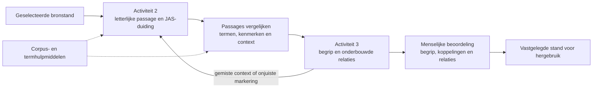

# INT terminologie voor Wetsanalyse activiteit 2 en 3

Onderzoek uitgevoerd op **8 oktober 2026**, met bijzondere verdieping van [alle hulpmiddelen op de INT-pagina](https://ivdnt.org/terminologie/hulpmiddelen/). Het resultaat is een websitekaart, een inventaris van **66 relevante concepten**, **102 afzonderlijke toolbeoordelingen** en een aanvullende beoordeling van **TermWerk**. De aanbevelingen hieronder sluiten aan op het bestaande [projectplan, spoor D](../../PLAN.md#d-activiteit-3-werkgebieden-en-begrippen); ze wijzigen dat plan of de software niet.

De belangrijkste opbrengst is de verbinding tussen **formuleringen terugvinden, betekenissen vergelijken en onderbouwde begrippen beheren**. Terminologische hulpmiddelen ondersteunen die werkzaamheden, maar hun extractiescores, woordenlijsten en consistentiecontroles bewijzen geen juiste juridische duiding. Voor activiteit 2 zijn corpusonderzoek en concordanties vooral nuttig als controle op gemiste formuleringen. Voor activiteit 3 zijn conceptgerichte fiches, contextvergelijking en afzonderlijke beoordelingsbeslissingen de sterkste aanknopingspunten.

## Bestanden en gebruik

| Bestand | Inhoud |
|---|---|
| [Verdieping en vergelijkingsvragen](verdieping.md) | Onderzoek naar de belangrijkste toepassingen, methodische lessen en voorgestelde proef |
| [Alle hulpmiddelen](hulpmiddelen.md) · [CSV](hulpmiddelen.csv) | Per vermelding: functie, Nederlands, omgeving, uitwisseling, toegang, oordeel, toepassing en beperking |
| [Alle concepten](concepten.md) · [CSV](concepten.csv) | Werkdefinities, bijdrage aan activiteit 2/3, voorbeelden en aansluiting op het project |
| [Websitekaart](websitekaart.csv) | Alle 18 sitemap-pagina’s in de terminologiesubboom en vier aansluitende ingangen |
| [Externe verwijzingen](externe-verwijzingen.csv) | 630 linkvermeldingen uit de onderzochte pagina’s, buiten de afzonderlijke toolcatalogus |
| [Bronnenregister](bronnen.json) | 206 bronrecords met leesstatus, vindplaatsen, opvraaggegevens en waar beschikbaar een responshash |

De CSV-bestanden zijn UTF-8 met een komma als scheidingsteken. Bron-ID’s in de tabellen verwijzen naar het JSON-register. Een bronrecord kan een mislukte opvraag of alleen metadata bevatten; het aantal bronrecords is daarom geen aantal volledig gelezen publicaties. De werkdefinities en projectadviezen zijn eigen synthese. Voorbeelden beschrijven fictieve situaties en doen geen uitspraak over geldend recht.

## Wat van de website is onderzocht

De hoofdingang bevat elf rubrieken. Samen met de projectpagina’s en evenementenarchieven zijn alle 18 pagina’s opgenomen die de geraadpleegde paginasitemap onder `/terminologie/` vermeldt. *Uitgelichte term* verwijst naar een archief buiten dat pad. TermWerk is langs aanvullende INT-verwijzingen onderzocht. [INT-overzicht](https://ivdnt.org/terminologie/), [paginasitemap](https://ivdnt.org/page-sitemap.xml).

| Onderdeel | Betekenis voor het traject | Onderzoeksdiepte |
|---|---|---|
| Wat is terminologie | Onderscheid tussen betekenis, aanduiding en vakcontext | Inhoud gelezen; praktische richtlijnen gericht gevolgd |
| Expertisecentrum | Terminologische deskundigheid en ondersteuning | Rol gelezen; geen contact opgenomen |
| Terminologieprojecten | Voorbeelden van corpusonderzoek, beschrijving en validatie | Alle vijf projectbeschrijvingen gelezen |
| Vakliteratuur | Theorie, definities, beheer, corpora en taaltechnologie | 425 bibliografische records in elf rubrieken geïnventariseerd; geselecteerde richtlijnen gelezen |
| Uitgelichte term | Voorbeelden van uitleg en context | Eerste archiefpagina en paginering; geen volledige inhoudelijke artikelcrawl |
| Termenlijsten | Vindplaatsen voor domeinonderzoek | Indeling en links in kaart; gerichte verdieping van juridische en bestuurlijke bronnen |
| Historische termenlijsten | Oude aanduidingen en veranderende betekenis | Overzicht gelezen; externe lijsten niet integraal onderzocht |
| Hulpmiddelen | Extractie, corpusonderzoek, beheer, kennisrepresentatie en zoeken | Alle 102 vermeldingen beoordeeld; actuele makersdocumentatie waar toegankelijk |
| Opleidingen | Benodigde terminologische vaardigheden | Overzicht gelezen; cursusaanbod niet afzonderlijk geverifieerd |
| Organisaties | Netwerk voor deskundigheid en standaarden | 87 organisaties uit kaartmetadata geïnventariseerd; sites niet allemaal bezocht |
| Evenementen en archieven | Ontwikkelingen en kennisuitwisseling | Drie overzichtspagina’s gelezen; presentaties niet integraal onderzocht |

De bibliografie is een onderzoeksingang, geen bewijs dat alle genoemde werken zijn gelezen. De elf rubrieken bevatten respectievelijk 100, 7, 25, 9, 25, 60, 116, 26, 26, 12 en 19 vermeldingen. De [externe verwijzingen](externe-verwijzingen.csv) zijn eveneens linkmetadata, geen inhoudelijke goedkeuring van alle bestemmingen.

**JuriTerm NL-VL is inhoudelijk het meest verwante INT-project.** Het onderzoekt juridische begrippen tussen Nederland en Vlaanderen met bronnen, gebruikscontext en rechtsvergelijking, gevolgd door controle door juristen. Het INT beschrijft daarbij een gespecialiseerd corpus en de ontwikkeling van JuriTermWerk. Dat is een relevant onderzoeksvoorbeeld; de projectpagina bewijst niet dat die omgeving al beschikbaar is voor inzet in Wetsanalyse AI. [JuriTerm NL-VL](https://ivdnt.org/terminologie/juriterm-nl-vl/).

De overige projecten geven aanvullende lessen. HOTNeV maakt het redactie- en accorderingsproces zichtbaar. *Nederlands als wetenschapstaal* verbindt corpusmateriaal met terminologische beschrijving. De twee medische projecten illustreren variatie naar doelgroep en regio. Mijn toepassing op Wetsanalyse: registreer naast een term altijd de context waarin zijn betekenis is onderzocht. [HOTNeV](https://ivdnt.org/terminologie/onderwijsterminologie-hotnev/), [wetenschapstaal](https://ivdnt.org/terminologie/nederlands-als-wetenschapstaal/), [MedPilot](https://ivdnt.org/terminologie/medische-pilot-medpilot/), [Medische Termen Belgisch-Nederlands](https://ivdnt.org/terminologie/medische-termen-belgisch-nederlands/).

## Aansluiting op de methode en het huidige project

Volgens de lokale *Handleiding Wetsanalyse in de praktijk* behandelt activiteit 2 het markeren en classificeren van formuleringen en het onderzoeken van hun samenhang. Activiteit 3 werkt onder meer namen, definities, kenmerken, relaties en voorbeelden uit. De methode is iteratief: begripsvorming kan eerdere markeringen en de bronselectie veranderen. De volledige methodische activiteit 3 gaat verder dan de huidige projectleveringen. Afleidingsregels en scenario’s vallen buiten de reeks in spoor D. Vindplaatsen: handleiding §3.4–3.5, leidraad *Ad 2* en *Ad 3*, boek hoofdstuk 3 stap 3; brongegevens M01–M03 in het [register](bronnen.json).

Het [platform](../../../README.md) ondersteunt momenteel activiteit 2, met dertien samengenomen JAS-labels. De officiële methodeclassificatie staat in [H2-JAS](../wetsanalyse-rijk/H2-JAS.md). Een filter op bijvoorbeeld *Rechtssubject* vormt nog geen verzameling synoniemen. De activiteit-3-werkplek is beschreven in [spoor D](../../PLAN.md#d-activiteit-3-werkgebieden-en-begrippen), maar is daarmee nog niet geïmplementeerd.

Mijn methodische vertaling van het onderzoek:

| Werkzaamheid | Bruikbare ondersteuning | Beslissing die bij de analist blijft |
|---|---|---|
| Formuleringen vinden | KWIC, frequenties, varianten en meerwoordpatronen | Welke formulering juridisch betekenis draagt |
| JAS classificeren | Context en taalkundige signalen | De functie van het fragment in de norm |
| Betekenisgroepen voorstellen | Variantzoeken en contextvergelijking | Of passages werkelijk hetzelfde begrip aanduiden |
| Begrip beschrijven | Fiches, kenmerken, definitiecontroles en voorbeelden | De betekenisafbakening en interpretatiekeuzes |
| Relaties uitwerken | Diagrammen en getypeerde verbanden | Soort, richting, geldigheid en onderbouwing van de relatie |
| Hergebruik en onderhoud | Historie, wijzigingssignalen en uitwisseling | Wat opnieuw moet worden beoordeeld en wat gepubliceerd mag worden |

## Relevante concepten

De [66 conceptfiches](concepten.md) maken de aansluiting afzonderlijk controleerbaar. Ze zijn gegroepeerd naar de vragen die de analist moet beantwoorden:

| Groep | Concepten | Praktische betekenis |
|---|---|---|
| Betekenis en aanduiding | C001–C013 | Term, begrip en voorkomen onderscheiden; varianten en equivalentie in context beoordelen |
| Definities en afbakening | C014–C022 | Kenmerken, begripsomvang, definitievormen, brondefinitie, voorbeelden en open normen |
| Relaties en modellen | C023–C030 | Soort, deel en associatie scheiden; JAS, SKOS en juridische relaties uit elkaar houden |
| Corpus en brononderzoek | C031–C038 | Afbakening, concordantie, alignering, frequentie, lemma en referentiecorpus |
| Extractie en AI | C039–C046 | Kandidaatstatus, uitsluitingsregels, betekenisonderscheiding en juridische foutanalyse |
| Beheer en beoordeling | C047–C055 | Beschrijvingsniveaus, status, rollen, bewijs, revisies, publicatie en dekking |
| Uitwisseling en hergebruik | C056–C062 | TBX, SKOS, NL-SBB, labelmetadata, betekenisbehoud en gegevensverantwoordelijkheid |
| Bronnen en gezag | C063–C065 | Woordenlijst versus rechtsbron, historische betekenis en brongetrouw taalgebruik |
| Methode en iteratie | C066 | Terugkoppeling van begripsvorming naar annotatie en bronselectie |

De praktische INT-ingangen naar [COTSOES-richtlijnen](https://www.cotsoes.org/en-publications) en [TermNet](https://termnet.eu/wp-content/uploads/2018/03/5-Steps-Action-Plan_Terminology-with-Ease-1.pdf) ondersteunen een belangrijk beheerprincipe: leg doel, verantwoordelijkheden en beoordelingsproces vast vóórdat de gereedschapskeuze het werkproces bepaalt. Voor gegevensbeschrijving sluiten [NL-SBB, versie 10 oktober 2024](https://docs.geostandaarden.nl/nl-sbb/def-st-nl-sbb-20241010/) en [SKOS](https://www.w3.org/TR/skos-reference/) aan op de al gekozen projectrichting. Dit onderzoek claimt geen NL-SBB- of ISO-conformiteit van het platform.

## Opbrengst van de hulpmiddelenverdieping

De INT-lijst bevat negen categorieën: alignering (5), corpusanalyse (8), online concordantie (7), termextractie (25), zelfstandig terminologiebeheer (27), beheer met grafische relaties (8), vertaalgeheugens (11), vertaalprojectbeheer (6) en zoekapplicaties (5). Tedi en TermStar zijn ieder tweemaal opgenomen: de 102 vermeldingen vertegenwoordigen na deze expliciete dubbeltellingen 100 productidentiteiten. TermWerk is aanvullend onderzocht. [INT-hulpmiddelen](https://ivdnt.org/terminologie/hulpmiddelen/).

| Onderzoeksvraag | Eerste vergelijkingskandidaten | Status van het advies |
|---|---|---|
| Welke formuleringen missen we? | AntConc, TextSTAT | Voorstel voor een controleerbare corpusproef |
| Wat voegen termkandidaten toe? | TermWerk, eventueel Sketch Engine | Voorstel voor vergelijking met dezelfde juridische beoordelingsset |
| Hoe werkt een bruikbare begripskaart? | Terminologue, TermWerk | Referenties voor gebruikerswerk en beoordeling |
| Hoe toon je relaties en betekenisverschillen? | Coreon, LookUp D.O.G., Tedi, i-Term | Ontwerpvoorbeelden; geen aanschafadvies |
| Hoe controleer je een formeel model? | Protégé | Kleine afzonderlijke proef mogelijk; geen juridische validator |
| Wat blijft bij uitwisseling behouden? | TermWerk, Qterm, eventueel Anchovy | Eerst veldmapping en proefexport onderzoeken |
| Hoe scheid je redactie en publicatie? | Graphite, Quickterm | Procesvoorbeelden voor de bestaande projectrichting |

De argumenten, documentatie en beperkingen staan per kandidaat in de [verdieping](verdieping.md). Geen van deze toepassingen is in dit onderzoek operationeel beproefd.

De lijst vraagt om zorgvuldige actualiteitscontrole. YouAlign meldt beëindiging op de eigen site. De bezochte Wordle-bestemming bevat andere inhoud dan de beschreven woordenwolk. De LexTerm-link bevestigt de bedoelde extractor niet. Verschillende tools leveren alleen een appschil, toegangscontrole of oude productpagina op. Dat laatste betekent **onvoldoende bewijs**, niet dat de software noodzakelijk is verdwenen. [YouAlign](https://youalign.com/), [LexTerm](https://github.com/LexTerm), [individuele beoordelingen](hulpmiddelen.md).

## Concrete aanbevelingen voor Wetsanalyse AI

Prioriteit P0 betekent: meenemen bij de eerstvolgende uitwerking van de activiteit-3-werkplek. P1 betreft gerichte toetsing of uitwisseling. P2 betreft latere uitbreiding. Dit zijn onderzoeksadviezen; het [bestaande projectplan](../../PLAN.md) blijft de enige bouwplanning.

| Nr. | Prioriteit | Aanbeveling | Verhouding tot het bestaande project | Controleerbaar resultaat |
|---|---|---|---|---|
| R01 | P0 | Houd begrip, term en bronvoorkomen herkenbaar gescheiden | Al voorzien in spoor D; terminologische verdieping | Een labelwijziging verandert geen broncitaat of begripsidentiteit |
| R02 | P0 | Toon concordanties naast de volledige bepaling | Aanvullende werkplekfunctie bij bronvergelijking | Iedere kandidaat is vanuit het overzicht in context te beoordelen |
| R03 | P0 | Maak brondefinitie, analysedefinitie en toelichting apart herkenbaar | Expliciet voorzien; behouden | De lezer ziet welke woorden uit de wet komen en wat de analist formuleerde |
| R04 | P0 | Benoem termstatus, redactionele status en juridische beoordeling afzonderlijk | Aanscherping van de bestaande reviewafspraken | Goedkeuring van een fiche keurt geen annotatie of koppeling impliciet goed |
| R05 | P0 | Beoordeel betekenisverschil vóór samenvoeging | Expliciet voorzien; concrete proefgevallen toevoegen | Gelijke woorden met ander bereik blijven gescheiden |
| R06 | P0 | Typeer relaties en onderbouw ze afzonderlijk | Expliciet voorzien; relatiekeuze aanscherpen | Soort-van, deel-van en juridische relaties blijven te onderscheiden |
| R07 | P0 | Gebruik grensgevallen bij definitiereview | Voorbeelden al voorzien; aanvulling op kwaliteitscriteria | Een te ruime of te nauwe definitie wordt bespreekbaar |
| R08 | P1 | Vergelijk corpus- en termextractie met juridische foutcategorieën | Nieuwe gerichte proef binnen bestaand validatiekader | Ook gemiste operators, uitzonderingen en eenmalige definities zijn gemeten |
| R09 | P1 | Maak import en export inhoudelijk toetsbaar | Uitwisseling voorzien; verliescontrole toegevoegd | Identiteit, context, bron, relatie en status zijn na overdracht vergelijkbaar |
| R10 | P1 | Definieer afzonderlijke export- en publicatieselecties | Aanvullend acceptatiecriterium | Een onbeoordeeld record wordt niet stil als vastgesteld hergebruikt |
| R11 | P1 | Onderscheid externe terminologie van juridische bewijsbronnen | Bronrollen voorzien; brongezag verduidelijken | Een woordenlijstverwijzing vervangt geen dragende rechtsbron |
| R12 | P2 | Verdiep meertalige en rechtsvergelijkende mappings pas bij concrete behoefte | Latere uitbreiding | Equivalentie heeft eigen context, onderbouwing en beoordeling |

Een externe terminologietoepassing toevoegen als tweede bron van waarheid zou de in spoor D voorziene bewijs- en beslisketen ingewikkelder maken. Mijn advies is daarom eerst de bestaande werkplek te verrijken met de aantoonbaar nuttige functies en externe toepassingen als vergelijkingsmateriaal te gebruiken. Er is op basis van documentatie alleen geen reden vastgesteld om de huidige API, PostgreSQL-opslag of graafprojectie te vervangen.

## Beperkingen en verantwoording

De dekking is volledig voor de **102 toolvermeldingen op de geraadpleegde INT-pagina** en de **18 sitemap-pagina’s binnen de afgesproken subboom**. Externe websites zijn gericht onderzocht; volledige functionaliteit, onderhoud, betaalde edities en licentiegeschiktheid zijn niet overal vast te stellen. Een uitspraak over Nederlands vermeldt daarom of zij taalanalyse, tekstverwerking, interface of alleen een INT-vermelding betreft.

De methodische vergelijking berust op lokale bronnen en projectdocumentatie; beschermde boeken en interne readers worden niet gepubliceerd. Openbare HTTP-responsen zijn lokaal bewaard in de genegeerde map `bronnen-lokaal/`. De hash in het register hoort bij die respons en kan dus ook een foutpagina identificeren. Bij via de webtool gelezen documentatie is dat afzonderlijk vermeld. Er zijn geen diensten ingericht, accounts aangemaakt of praktijkmetingen uitgevoerd. Het [proefvoorstel](verdieping.md#vergelijkingsproef-voor-activiteit-2-en-3) beschrijft wat nog nodig is om geschiktheid aantoonbaar te maken.
